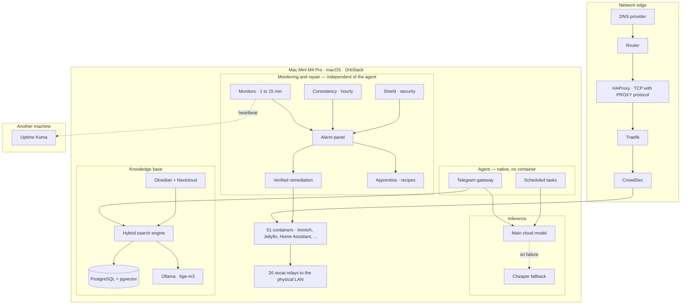

# Architecture

## The constraints

Every non-obvious decision in this system comes from four constraints. They are worth stating before the diagrams, because otherwise several choices look like beginner mistakes.

### One machine

A Mac Mini M4 Pro with 64 GB of unified memory. No cluster, no second node to fail over *to*.

The practical consequence is that **availability doesn't come from redundancy but from recovery speed**. There is no way to survive this machine going down; the only thing that can be optimised is how long it takes to come back, and how much is lost on the way. That is why the effort goes into verified backups, automatic recovery and causing failures on purpose to measure that recovery, not into high availability.

It also means anything I install competes for the same memory. The local embedding model, the 51 containers, PostgreSQL and an object detector for the cameras share the same 64 GB. For months a local 9B language model shared it too; it left the machine once it was clear it didn't pay off (told further down).

### macOS

The container runtime is OrbStack. Containers run on a virtualised network that **can't reach the physical LAN directly**.

On Linux with `network_mode: host` this wouldn't be a problem: the container shares the host's network stack and sees the local network like any other process. On macOS that mode doesn't really exist, because containers live inside a lightweight virtual machine with its own network.

For almost everything it doesn't matter: a web server only needs requests to reach it. For home automation and the cameras it is decisive, because their whole job is talking to devices on the other side of that boundary. It is the constraint behind the strangest part of this system, and it has its own section further down.

### Home

The blast radius of an outage is that my family can't watch a film or the lights don't turn on by themselves.

That risk budget buys two things. It allows **aggressive automation**: the system restarts containers on its own, databases and the password manager included, something that in production would demand much more ceremony. And it rules out any technology whose operating cost is only justified at scale.

That is why there is no Kubernetes, no Prometheus and no queueing system here. Not because they are bad tools: each one would bring a system that in turn has to be operated, updated and monitored, to solve problems a single node doesn't have.

### Cost sensitivity

Cloud inference is paid per token. An interactive agent you message twenty times a day has a negligible cost. A scheduled task that runs every hour, unsupervised, carrying context and making several tool calls, doesn't.

The first design answer was to send everything automatic to a local model. It didn't survive contact with reality: a small model fails silently on long tasks, and the savings didn't make up for the time lost finding out. Today the answer is different: **automatic work that doesn't need a model doesn't use one** (the daily report, the agenda, monitoring and backups are deterministic code), and what does need one goes to a cloud model with a cheaper fallback, with the cost of each call recorded.

---

## The layers

---

## The containers

The diagram above collapses most of this into a single box. Unfolded, it is
far more heterogeneous than a rectangle suggests, and useful to see at a
glance how much lives on a single machine.

### Network and edge

| Container | What it does |
| --- | --- |
| Traefik | Reverse proxy. Routes traffic to the right container by domain, with source-based access middlewares |
| CrowdSec | Detects abuse patterns in Traefik's logs and feeds a shared blocklist |
| Pangolin | Tunnels to expose specific services without opening extra ports |
| Gerbil | The tunnel endpoint that talks to Pangolin |
| Cloudflare DDNS | Keeps the DNS record pointing at the public IP, which changes |

In front of all of them, outside Docker, **HAProxy** runs on the Mac itself: it receives port 443 and hands it to Traefik with *PROXY protocol*, so that Traefik and CrowdSec see the client's real IP instead of the OrbStack network bridge's. Without it, CrowdSec would block (or forgive) everyone at once.

### Home automation

| Container | What it does |
| --- | --- |
| Home Assistant | The home automation platform itself: automations, integrations, dashboard |
| Zigbee2MQTT | Bridge between the Zigbee coordinator and the rest of the system, over MQTT |
| Matter Server | Matter protocol support for the devices that speak it |
| Mosquitto | The MQTT broker Home Assistant and Zigbee2MQTT communicate over |
| Frigate | Camera recorder with person detection; also feeds the live image to Home Assistant |

### Media

| Container | What it does |
| --- | --- |
| Jellyfin (×4) | Video, music, podcasts and a separate instance for a relative, each with its own library and users |
| Audiobookshelf | Audiobooks, with progress tracking |
| qBittorrent and Jackett | Download client and its search engine |
| YouTube token provider | Helper for podcast downloads |

### Productivity and data

| Container | What it does |
| --- | --- |
| Nextcloud | Files, calendar, tasks: the collaboration server |
| Nextcloud database | MariaDB dedicated to that instance |
| Nextcloud cache | Redis for sessions and application cache |
| Vaultwarden | Password manager, compatible with the Bitwarden protocol |
| CouchDB + LiveSync bridge | Sync the notes vault between the server and the devices |
| Stirling PDF | PDF manipulation tools with a web interface |
| n8n | Workflow automation between services |

### Photos

| Container | What it does |
| --- | --- |
| Immich (server) | Photo and video management and backup from the phone |
| Immich (machine learning) | Face and object recognition over the library |
| Immich (database) | PostgreSQL with the vector extension recognition uses |
| Immich (cache) | Redis for queued jobs and cache |

### Search, knowledge and AI

| Container | What it does |
| --- | --- |
| Hybrid search engine | The service described below; the agent uses it as an MCP server |
| Engine database | PostgreSQL with pgvector, dedicated to embeddings |
| Open WebUI | Chat interface to talk to the models directly |

### Own portals

| Container | What it does |
| --- | --- |
| Monitoring | The monitoring panel: alarm panel, remediation, antifragility, consistency and scheduled tasks |
| Ticketing | The homelab's single to-do list |
| Home page | Shortcuts to everything else |
| Shield | The security portal: exposure, access, local network, patches |
| Cinema, running, energy | Everyday portals, with their own data |
| Showcase | The only public page: a summary of the homelab with live figures |

They all share the same per-portal login and, except the showcase, only answer from the home network.

### Monitoring

| Container | What it does |
| --- | --- |
| Beszel (+ agent and Docker socket proxy) | CPU, memory and disk of the machines on the network, with its own dashboard |
| Speedtest Tracker | Measures the connection at regular intervals and keeps the history |
| Alert service | Receives warnings from the external observer and forwards them to Telegram |

### Creativity

| Container | What it does |
| --- | --- |
| Minipaint | Lightweight image editor, in the browser |

---

## The agent

### What it is and why it isn't in a container

A conversational agent reachable from Telegram, built on Hermes Agent. You write to it as you would to a person, and it can answer questions, query the knowledge base, or run actions on the infrastructure and the house.

It runs as a **native operating system process, not inside a container**. The agent manages the container runtime: its tools include listing containers, reading their logs and restarting them.

### What it doesn't do

The most important design decision about the agent is a negative one: **nothing essential depends on it**. Monitoring, repair, backups, recovery after a power cut and the daily report are deterministic code that runs on its own. If the agent goes down, you lose the conversation and little else.

It wasn't like this from the start. The first version of the daily report, the agenda and part of the monitoring were agent tasks, and every agent failure (a model down, a key out of credit, an update that broke something) took down things that had nothing to do with it.

### The three kinds of work

**Interactive.** Questions and commands over Telegram. Here a human is waiting for an answer, and latency and quality matter.

**Scheduled.** Few tasks, and only those that really need a model: a news digest and maintenance of its own memory. Everything else that was scheduled left the agent.

**Memory consolidation.** A nightly pass that compacts the conversation history into durable notes, so the agent doesn't drag everything ever said along indefinitely.

On top of that, the system **wakes it up** when judgment is needed: after a power cut it receives the recovery report to review what was left pending, and when a failure has no known recipe, the Apprentice asks it to fix it (see [Reliability](case-studies/reliability.md)).

### Who may restart what

For months the containers were classified: one group (databases, password manager, home automation, reverse proxy) was marked critical, and **the system could alert about them but not touch them**. The reasoning was that a blind restart of a database with writes in flight can turn a minor incident into data corruption.

That line moved. What justified it was the *blind*, and it stopped being blind: today every restart is decided with the container's evidence in front of it, it is **verified** afterwards (the command returning 0 isn't enough) and it has a circuit breaker if it repeats. With that, waiting for a human to read the alert turned out to be riskier than restarting. Critical containers still exist, but as a priority, not as a prohibition.

### Models

| Workload | Backend | Why |
| --- | --- | --- |
| Interactive chat and agent tasks | Main cloud model | With a human waiting, quality rules |
| If the main one fails (outage, key, credit) | Cheaper fallback, announced | The agent keeps answering while it gets fixed |
| Deciding whether a repair action applies | The same pair, with the cost per call recorded | See [Reliability](case-studies/reliability.md) |

Switching to the fallback is automatic and announced on Telegram: an agent that changes model silently is another of those systems that report green without being green.

### The local model that left

For months the scheduled tasks ran on `qwen3.5-9b` locally, for cost. That period left the most useful finding about small models in the whole project.

`qwen3.5-9b` reliably handles **a single tool call**. You ask for disk usage, it calls the tool, receives the result, writes the answer. Perfect.

When the task requires **several chained calls** (check the status, decide what to look at next, check something else, and then summarise) the model loses the thread from the third or fourth one on and does something very specific: **it narrates what it plans to do instead of doing it**. The output is along the lines of *"now I'll check the status of the containers and prepare a summary"*, instead of the summary.

The insidious part is the failure mode. The task **ends with exit code 0**. No exception, no timeout, no error in any log. The output is grammatically perfect, plausible prose. If the message reaches Telegram at three in the morning and you skim it, it looks like it worked.

First the multi-tool tasks went back to the cloud. Then the single-tool ones stopped needing a model: they were reports that could be written in code. In the end the local model had no work left, and freed the memory it was using. The operational conclusion still stands: **a small model degrades silently instead of failing loudly**, and that is only found by leaving something running unsupervised for weeks.

---

## The knowledge base

### What it indexes

A hybrid-search RAG over about 2,000 pages coming from two very different sources:

- An **Obsidian vault**: personal markdown notes, densely linked to each other. It includes all the homelab's operational documentation.
- A **Nextcloud** instance: office documents, PDFs, spreadsheets, and everything one piles up on a file server. Folders with especially sensitive data are excluded on purpose.

Current total: **about 2,080 pages and 11,200 chunks**, all embedded.

The agent queries it through an MCP server, from Telegram with dedicated commands and also internally when a question needs context that isn't in the conversation.

### Why retrieval is hybrid

Two searches run in parallel over the same system:

**Dense vector search.** Each chunk is represented by a 1,024-dimension vector, indexed with HNSW on pgvector. The query is turned into a vector and the nearest chunks are found by cosine similarity. It captures meaning: it finds documents about the same thing even if they don't share a single word.

**Lexical search.** PostgreSQL full-text with `tsvector`, ranked with BM25. It looks for the literal words of the query, weighting by frequency and rarity.

The two result sets are combined with **reciprocal rank fusion**: instead of trying to compare scores on incompatible scales, only each document's *position* in each list is used. A document that comes third in one and fifth in the other scores better than one that comes first in one and doesn't appear in the other. It is a simple method and surprisingly robust precisely because it ignores the scores.

**Neither was enough on its own**, and the reason is very concrete in an operational corpus. Vector search handles paraphrase well, but misses exact identifiers: a container name, an error code, a port number. And those identifiers are exactly what an operational question is about. Asking a semantic search engine about `nextcloud_redis` returns documents about Redis and about Nextcloud, not the one that mentions that specific container.

Lexical search nails those cases and fails spectacularly with anything phrased differently from the original.

### Local embeddings

Embeddings are generated with Ollama on `bge-m3`, 1,024 dimensions, on the same machine. It replaced `nomic-embed-text` (768 dimensions), and the change forced re-embedding the whole corpus.

**The reason they are local is that the corpus contains private data.** Sending personal notes and family documents to a third-party embedding API was ruled out before evaluating any, so the decision wasn't made on quality or price.

The cost is real and deserves stating instead of hiding. It limits model choice to what fits in memory alongside everything else, which in practice means smaller models than commercial APIs offer. And it makes reindexing the whole corpus an operation measured in hours rather than minutes.

### Incremental reindexing

It runs every night. It walks both sources, detects what changed since the last pass, and **only re-embeds what was modified**. Reprocessing 11,000 chunks every night would be absurd when twenty change on a normal day.

The reindex **fails loudly**: if a source returns zero documents, or doesn't answer, it ends with an error instead of accepting an empty pass. For a while it didn't, and a source that was down turned into an index that aged without anything saying so.

### The two sources behave differently

And that shapes the pipeline more than you expect when building it.

The Obsidian vault is small, densely linked and **written to be read**: it has titles, structure, and the notes reference each other. It produces few chunks per document and answers conceptual questions very well, because the text itself is already organised by ideas. Its tags are injected as text before indexing, so they count in search.

Nextcloud is the opposite: long documents, with no usable structure, many of them PDFs and spreadsheets whose text has to be extracted. It contributes the bulk of the page count, and it needs limits (size per file, rows per sheet, time per document) so that a single pathological file doesn't block the whole pass.

The result is asymmetric and worth keeping in mind: **most of the corpus by volume lives in Nextcloud, and most of the useful answers come from the vault.**

---

## The genuinely odd part: the relays

### The problem

Home Assistant runs in a container. Its whole job is talking to physical devices on the LAN, with several different protocols and transports (some TCP, one UDP, each with its own port). The same goes for Frigate and the cameras.

**They can't reach any of them.** The container network is virtualised and isolated from the physical network, for the reasons explained in the constraints.

Without solving this, the home automation platform controls absolutely nothing.

### The solution

**26 `socat` relays** running **natively on the host**, outside Docker. Each one listens on a host port and forwards all traffic to the address and port of a specific LAN device.

The container is configured to talk to the host on that port. The host talks to the device. To the container it is transparent: it thinks it is talking to the device.

They are managed as system services, so they come up on their own when the machine boots and launchd relaunches them if they die.

### Why it is fragile

It works well and it's stable. The problem is something else: **each relay is an independent point of failure, invisible from inside the container.**

When a relay dies, Home Assistant gets no useful error. It simply stops receiving data from those devices and shows them as unavailable, exactly as if the device were switched off or off the wifi. There is nothing in the container's logs pointing at the relay, because from its point of view the relay doesn't exist.

The right diagnosis (checking whether the relay process is still alive on the host) isn't where anyone looks first.

When there were nine, auditing their coverage produced one of this project's findings: several weren't monitored at all, and the line in the daily report that claimed to report on them was counting other things. Today a checker walks all 26 every few minutes (that the process is alive and that the port answers) and any failure reaches the alarm panel. It is covered in [Reliability](case-studies/reliability.md).

---

## Monitoring

### Layers, and one rule

| Layer | Question it answers | Where it runs | Every |
| --- | --- | --- | --- |
| Monitors | Is each piece up and doing its job? | On the host | 1 to 15 min |
| Alarm panel | What is wrong right now, in one place? | On the host | continuous |
| Remediation and Apprentice | Can it be fixed without anyone doing anything? | On the host | 1 to 5 min |
| Consistency | Do the lists that should match actually match? | On the host | hourly |
| Shield | What is exposed, who is trying to get in, what changed? | On the host | 30 min |
| Uptime Kuma | Is the whole machine alive? | **On another machine** | continuous |
| Data disk watcher | Is the disk where everything else lives still mounted? | **On the system disk** | 60 s |

The rule across all layers: **none of this depends on the agent**. They are deterministic scripts, each with its heartbeat, and every heartbeat watched.

The monitors don't only check that a container is running, but that **the service is doing its job**: that the home automation API answers, that the Zigbee bridge is connected, that sensors keep reporting, that batteries aren't flat, that both DNS resolvers answer, that the backup disk set is still complete. A container can be perfectly up and have lost its connection to half the house.

**All local monitors share a failure mode**: if the machine shuts down, hangs or loses the network, whatever was going to warn you goes down too. The external observer, running on different hardware, is the only component able to report the total failure of everything else. And it has to alert **without going through the Mac**: for months its Telegram notification went out through a service that lived on the Mac itself, so with the Mac off the only possible alert never arrived. It was discovered by causing a blackout on purpose.

The same applies to the data disk: the watcher that checks it is still mounted lives on the system disk, because a watcher stored on the disk it watches disappears with it.

### Who watches the watcher?

There is no clean answer, but there are partial ones: the external observer receives a heartbeat from the Mac and the Mac checks that the observer answers; the Telegram channel has its own heartbeat; and each monitor leaves a heartbeat that the alarm panel watches, so a monitor that stops running is an alarm, not a silence.

### Each monitor, one by one

| What it does | Every |
| --- | --- |
| Checks that the data disk is still mounted and responding | 60 s |
| Watches containers: up, resource usage, real health when declared | 5 min |
| Decides and runs remediation of containers and services | 5 min |
| Checks the relays, the DNS resolvers and the backup disk set | 5 min |
| Sends a heartbeat to the external observer | 5 min |
| Reviews home automation integrations: API, Zigbee bridge, sensors, batteries, cameras | 15 min |
| Reviews security: ports, access, local network, patches | 30 min |
| Cross-checks the lists that should match (proxy, portals, heartbeats, services) | hourly |
| Backs up the data disk and the database dumps | daily, 02:00 |
| Takes a snapshot with history of the whole backup | daily, 04:15 |
| Reindexes the knowledge base | daily, 04:45 |
| Verifies the night's backups: seventeen checks | daily, 06:30 |
| Sends the day's status report | daily, 09:00 |
| Aggregates and purges old metrics | weekly |
| Updates container images, with automatic rollback if one fails to start | weekly |

### Alerts only on state change

A design detail that shapes the whole behaviour: monitors keep the last known state of each item in a file, and **only notify when that state changes**.

Without it, a container down for a day would generate 288 identical messages. With it, it generates one when it goes down and another when it recovers.

It has a downside that took me months to see: a problem that resolves itself again and again produces a sequence of isolated recovery messages, and those don't trigger any mental alarm. It is exactly the mechanism by which 49 restarts of the same container went unnoticed.

And another one that only shows up when causing failures: after a boot, or after an Internet outage, many monitors see at once things that are still starting. Without a grace window, every power cut produced dozens of alerts about things that fixed themselves two minutes later. Now new outages are **held** during boot and during an Internet outage, and only the ones still there when the window ends are reported.

### Maintenance window

There is a command that silences all alerts for a number of minutes. It writes a timestamp to a file and every monitor checks it before notifying.

It is what allows updating images or restarting things by hand without getting twenty messages. Metrics keep being recorded during the window: a silenced incident is still data.

### SQLite

Metrics go to a SQLite file. It is a deliberate downgrade from the industry standard, and worth arguing because it looks like laziness.

This is **one node**, with a five-minute sampling interval and a few dozen series. In that regime, SQLite means: no extra container to maintain, no scraping configuration, no retention subsystem to learn to operate, no new query language, and a file that goes into the nightly backup without doing anything special.

Prometheus and Grafana are the right answer with ten nodes, when you need automatic target discovery, or alerting rules expressed over the metrics themselves. With one, they are two more services that in turn need monitoring, to solve a problem that fits in a file of a few megabytes.

**The reversal condition is written down**: around ten nodes, or the first time I want alerts computed over the series rather than over the raw checks.

Retention is explicit and not a database feature: full resolution for 30 days, then hourly averages kept indefinitely. The design and its two safety guarantees are in [Reliability](case-studies/reliability.md).

---

## Storage and recovery

### The topology

Four volumes with well-separated roles.

**Mac Mini internal disk, ~500 GB.** The operating system and applications, and two things that must survive the data disk going down: that disk's watcher and the backup logs. **No homelab data lives here**, not even the container volumes.

**Data NVMe, 2 TB, in an external enclosure.** Everything in use:

- The volumes of the 51 containers: databases, configuration and state of Immich, Jellyfin, Nextcloud, Vaultwarden, home automation and the rest
- The photo library and the audio library
- The notes vault
- The homelab project itself: scripts, documentation, state files and the metrics database

**10 TB disk.** Two things that look nothing alike:

- The **daily backup** of the data NVMe, plus the agent's configuration
- The **video library**, which lives here directly: it is the original, not a copy of anything

**Backup set, 11 TB, two concatenated disks.** The backup with history of the whole 10 TB disk: one snapshot per day, where what didn't change is hard links and only what's new takes space. Three dailies, two weeklies and one monthly are kept.

### From a mirror to two copies

The first version kept the backup on a RAID 1 mirror of two 5 TB disks, and the video library lived on that same mirror **with no copy anywhere else**: its only protection was against a single disk dying at a time, not against an accidental deletion.

The mirror failed exactly the way mirrors fail. One of the disks, connected over USB, dropped out of the set; it was rebuilt, and the same day it was degraded again. **For eleven days the volume kept working on a single disk.** The RAID checker alerted on Telegram and logged it every five minutes; nobody read it, because it arrived on the same day the problem was considered solved. An alert nobody reads is the same lesson as the 49 restarts, by another route.

The disk was retired, space ran short, and the question that guided the new layout was the usual one: **if this disappears, can it be got back?** The answer led to giving up the mirror and having **two independent copies**: the 10 TB disk holds the night's backup and the original video library, and the backup set holds the history of all of it, video included.

The backup set is a concatenation, not a mirror: if either of its two disks fails, **that entire copy** is lost. It is an accepted and written-down risk, because the original is still on the 10 TB disk, and a checker alerts as soon as the set stops being complete. A component whose design consists of tolerating (or accepting) a failure needs someone watching whether the failure has arrived.

**Live data is not on the system disk.** That allows reinstalling macOS, or replacing the whole machine, without touching anything in the homelab: the container volumes are on a separate disk that gets plugged into the new hardware.

### What gets backed up

Every night at 02:00: **the whole data disk**, the agent's configuration, and **a consistent dump of every database**. At 04:15, the snapshot with history.

The night's three tasks (backup, snapshot and verification) are **chained**: if one doesn't happen (a power cut, a disconnected disk), the boot script relaunches it on return, in order.

### The open database problem

Copying the files of a database that is writing produces a copy that may not be restorable: you capture half a transaction, or an index that no longer matches the data.

The backup solves it in two steps, and the order matters:

**Before copying anything**, it produces a consistent dump of each database. For SQLite it uses the engine's own `.backup` command, which produces a consistent file even with writes in progress, with retries and a check that the dump isn't empty or damaged; for PostgreSQL and MariaDB, a full SQL dump.

**Then it copies**, excluding the live files of those same databases. PostgreSQL and MariaDB data directories, WAL files, journals and SQLite `-shm`/`-wal` files **are left out of the copy on purpose**: they are exactly the ones that can't be copied hot, and they are already represented by their dump.

Caches, video transcodes, sockets and process files are excluded too. None of that is data: it is rebuildable state that would only make the backup slower and bigger.

It is a plumbing detail and it is where you decide whether a backup is any good. A copy that includes a database's live directory looks complete (it weighs what it should, the files are there) and doesn't start when restored.

### The part that really matters

The interesting half isn't the backup, it's the verification. And the other interesting half is the restore.

**Seventeen checks run at 06:30**, and the report arrives on Telegram **whether they pass or fail**. They check that each dump exists, is from tonight and isn't suspiciously small; that the data really reached the destination disk; that the backup log ends with its summary; and that the snapshot with history is complete, has what it should and pruning is up to date.

The reason this exists is that **the failure mode of backups is silent**. They don't stop working with a crash: they stop working, everything else stays the same, and you find out the day you need to restore. An unverified backup isn't a backup, it's a hypothesis.

The report arriving when everything is fine too is intentional: if it only arrived on failure, the absence of messages would be ambiguous between "all good" and "the verifier is broken too".

But a verification only says the copy is there. To know whether it **works**, there are scripted restore drills for the services that matter most (password manager, home automation, photos and files): each one brings up last night's copy separately, with no network and without touching the real service, checks that it starts and has what it should, and cleans up after itself. The first one found that the password manager backup was intact, but that nobody knew how to decrypt it without improvising.

---

## What's missing on purpose

**No Kubernetes.** One node. Its scheduling machinery, service discovery, rolling updates and autoscaling solve problems that appear when you have many machines and many teams. None of those problems exist here, and in exchange it would bring a control plane that in turn has to be updated, backed up and monitored. Complexity has to pay for itself.

**No cloud storage for private data.** Photos, documents and notes stay on hardware I own. It is the reason for the local embedding model, for a good part of the operational load, and for this backup system existing in the first place. It is a values decision more than a technical one, and it has a price paid in work.

**No high availability, and no UPS.** Recovery is fast and rehearsed (power cuts are caused on purpose to measure it); uptime isn't guaranteed. For a home, mean time to recovery is the number worth optimising, and it comes out orders of magnitude cheaper than mean time between failures.

**No secrets in the repository.** Credentials are loaded at runtime from files outside version control, with restrictive permissions, and with automatic scanning that prevents committing a token by accident. This **wasn't true from the start**: there were credentials hard-coded in six scripts. It is told in [Decisions and mistakes](decisions.md) and in [Security audit](case-studies/security.md).
