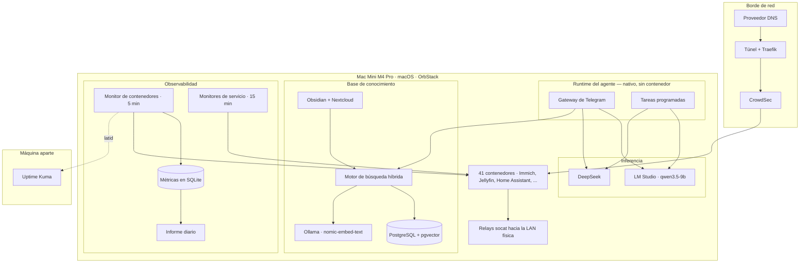

# Arquitectura

## Las restricciones

Todas las decisiones no obvias de este sistema salen de cuatro restricciones. Conviene enunciarlas antes que los diagramas, porque si no varias elecciones parecen errores de principiante.

### Una sola máquina

Un Mac Mini M4 Pro con 64 GB de memoria unificada. Sin clúster, sin un segundo nodo *al que* hacer failover.

La consecuencia práctica es que **la disponibilidad no viene de la redundancia sino de la velocidad de recuperación**. No hay forma de sobrevivir a que esta máquina se apague; lo único que se puede optimizar es cuánto se tarda en volver, y cuánto se pierde por el camino. De ahí que el esfuerzo esté puesto en backups verificados y en recuperación automática, y no en alta disponibilidad.

También significa que cualquier cosa que instale compite por la misma memoria. El modelo de embeddings local, los 41 contenedores, el modelo de lenguaje de 9B cargado a 64K de contexto y PostgreSQL conviven en los mismos 64 GB. Eso acota qué modelos se pueden usar mucho más que cualquier consideración de calidad.

### MacOS

El runtime de contenedores es OrbStack. Los contenedores corren en una red virtualizada que **no alcanza la LAN física directamente**.

En Linux con `network_mode: host` esto no sería un problema: el contenedor comparte la pila de red del anfitrión y ve la red local igual que cualquier proceso. En macOS no existe ese modo real, porque los contenedores viven dentro de una máquina virtual ligera con su propia red.

Para casi todo da igual: un servidor web solo necesita que le lleguen peticiones. Para la domótica es determinante, porque su función entera consiste en hablar con aparatos que están al otro lado de esa frontera. Es la restricción que genera la parte más rara de este sistema, y tiene su propia sección más abajo.

### Hogar

El radio de impacto de una caída es que mi familia no pueda ver una película o que las luces no se enciendan solas.

Ese presupuesto de riesgo compra dos cosas. Permite **automatización agresiva**: un monitor tiene permiso para reiniciar contenedores por su cuenta sin pedir permiso, algo que en producción exigiría bastante más ceremonia. Y descarta de plano cualquier tecnología cuyo coste operativo solo se justifica a escala.

Es la razón por la que aquí no hay Kubernetes, ni Prometheus, ni un sistema de colas. No es que sean malas herramientas: es que cada una traería consigo un sistema que a su vez hay que operar, actualizar y monitorizar, para resolver problemas que un solo nodo no tiene.

### Sensibilidad al coste

La inferencia en la nube se paga por token. Un agente interactivo al que le escribes veinte veces al día tiene un coste despreciable. Una tarea programada que corre cada hora, sin supervisión, arrastrando contexto y haciendo varias llamadas a herramientas, no.

La consecuencia de diseño es que **todo lo automático va por defecto a un modelo local**, y solo se sube a la nube lo que se demuestre que el local no puede hacer. Esa demostración llegó, y está contada más abajo.

---

## Las capas

---

## Los contenedores

El diagrama de arriba colapsa la mayoría de esto en una sola caja. Desplegado,
es bastante más heterogéneo de lo que sugiere un rectángulo — útil de ver de
un vistazo cuánto convive en una sola máquina.

### Red y borde

| Contenedor | Qué hace |
| --- | --- |
| Traefik | Proxy inverso. Enruta el tráfico entrante hacia el contenedor correcto por dominio |
| Pangolin | Expone servicios seleccionados a internet a través de un túnel, sin abrir puertos en el router |
| Gerbil | El extremo del túnel que habla con Pangolin — el componente que de verdad mantiene la conexión saliente |
| CrowdSec | Detecta patrones de abuso en los logs de Traefik y alimenta un bloqueo compartido |
| DDNS a Cloudflare | Mantiene el registro DNS apuntando a la IP pública, que cambia |
| Sincronización de AdGuard | Mantiene en paridad la configuración entre los dos resolvers DNS de la red |

### Domótica

| Contenedor | Qué hace |
| --- | --- |
| Home Assistant | La plataforma de domótica en sí — automatizaciones, integraciones, panel de control |
| Zigbee2MQTT | Puente entre el coordinador Zigbee y el resto del sistema, vía MQTT |
| Matter Server | Soporte del protocolo Matter para los dispositivos que lo hablan |
| Mosquitto | El broker MQTT sobre el que se comunican Home Assistant y Zigbee2MQTT |

### Multimedia

| Contenedor | Qué hace |
| --- | --- |
| Jellyfin (vídeo) | Streaming de la videoteca |
| Jellyfin (audio) | Streaming de música, como instancia separada de la de vídeo |
| Audiobookshelf | Audiolibros y podcasts, con seguimiento de progreso |
| qBittorrent | Cliente de descargas |

### Productividad y colaboración

| Contenedor | Qué hace |
| --- | --- |
| Nextcloud | Ficheros, calendario, tareas — el servidor de colaboración |
| Base de datos de Nextcloud | MariaDB dedicada a esa instancia |
| Caché de Nextcloud | Redis para sesiones y caché de la aplicación |
| Puente de calendario | Sincroniza eventos por CalDAV con el agente conversacional |
| Syncthing | Sincronización de ficheros entre dispositivos, sin depender de un servidor central |
| Stirling PDF | Herramientas de manipulación de PDF con interfaz web |
| n8n | Automatización de flujos de trabajo entre servicios |
| Open WebUI | Interfaz de chat para hablar con los modelos locales y en la nube |
| Vaultwarden | Gestor de contraseñas, compatible con el protocolo de Bitwarden |

### Creatividad

| Contenedor | Qué hace |
| --- | --- |
| Excalidraw | Pizarra colaborativa para diagramas a mano alzada |
| Minipaint | Editor de imágenes ligero, en el navegador |

### Fotos

| Contenedor | Qué hace |
| --- | --- |
| Immich (servidor) | Gestión y backup de fotos y vídeo desde el móvil |
| Immich (aprendizaje automático) | Reconocimiento facial y de objetos sobre la biblioteca |
| Immich (base de datos) | PostgreSQL con la extensión vectorial que usa el reconocimiento |
| Immich (caché) | Redis para tareas en cola y caché |

### Búsqueda y conocimiento

| Contenedor | Qué hace |
| --- | --- |
| Motor de búsqueda híbrida | El servicio descrito en la sección siguiente |
| Base de datos del motor | PostgreSQL con pgvector, dedicada a los embeddings |

### Observabilidad y estado del proyecto

| Contenedor | Qué hace |
| --- | --- |
| Beszel | CPU, memoria y disco de las máquinas de la red, con panel propio |
| Agente de Beszel | Se instala en cada máquina vigilada y reporta al servidor central |
| Proxy hacia el socket de Docker | Da a Beszel visibilidad de los contenedores sin exponerle el socket directamente |
| Speedtest Tracker | Mide la conexión a intervalos regulares y guarda el histórico |
| Homepage | Página de inicio con accesos directos a todo lo demás |
| Panel del proyecto | El dashboard de este propio proyecto de monitorización |
| Proxy del panel del proyecto | Mismo patrón que el proxy del recolector de métricas |
| Servicio de alertas | Punto de entrada común al que el resto de monitores puede mandar avisos |

### Parado a propósito

| Contenedor | Qué hace |
| --- | --- |
| Grabador de vídeo de cámaras | Apagado de forma intencionada — las cámaras físicas están desconectadas. Su histórico de reinicios aparece igualmente en la distribución de incidentes: ver [Fiabilidad](case-studies/reliability.md) |

---

## El agente (Hermes Agent)

### Qué es y por qué no está en un contenedor

Un agente conversacional accesible desde Telegram. Le escribes como a una persona, y puede responder preguntas, consultar la base de conocimiento, o ejecutar acciones sobre la infraestructura (por ejemplo, Home Assistant).

Corre como **proceso nativo del sistema operativo, no dentro de un contenedor**. El agente gestiona el runtime de contenedores: entre sus herramientas están listar contenedores, leer sus logs y reiniciarlos.

### Las tres clases de trabajo

**Interactivo.** Preguntas y comandos por Telegram. Aquí hay un humano esperando una respuesta, y la latencia y la calidad importan.

**Programado.** Un puñado de tareas recurrentes: un resumen diario del estado del sistema, un digest de noticias, mantenimiento de la base de conocimiento. Corren sin nadie mirando, a horas fijas, y su salida llega a Telegram.

**Consolidación de memoria.** Una pasada nocturna que compacta el historial de conversación en notas duraderas, para que el agente no arrastre indefinidamente todo lo que se ha dicho.

### Aprobación humana cada vez que elimina algún elemento

Los contenedores están clasificados. Un grupo —bases de datos, gestor de contraseñas, domótica, proxy inverso— está marcado como crítico: **el sistema puede alertar sobre ellos pero no tocarlos**.

El razonamiento es que un reinicio a ciegas de una base de datos con escrituras puede convertir una incidencia menor en corrupción de datos. Para el resto, reiniciar es casi siempre inocuo y casi siempre resuelve, así que se automatiza.

Esa frontera entre "actúa solo" y "pregunta primero" es una decisión de diseño, no una limitación técnica, y está definida por una lista explícita en el código.

### Enrutado de modelos

Cada petición va a uno de los dos backends según su complejidad, no según preferencia:

| Carga de trabajo | Backend | Por qué |
| --- | --- | --- |
| Chat interactivo | DeepSeek (cloud) | Con un humano esperando, manda la calidad |
| Tareas de una sola tool | `qwen3.5-9b` en LM Studio (local) | Corre sin supervisión y a menudo; el coste debe ser cero |
| Tareas multi-tool | DeepSeek (cloud) | Ver abajo |

El modelo local corre en LM Studio, que expone una API compatible con OpenAI en `localhost`, cargado a 64K de contexto. Se levanta al arrancar la máquina mediante un servicio del sistema, porque si no está disponible las tareas programadas se quedan sin backend.

### El hallazgo que forzó la tercera fila

La tercera fila de esa tabla no es una preferencia: es el resultado de que algo fallara durante semanas sin que me diera cuenta.

`qwen3.5-9b` resuelve con fiabilidad **una única llamada a herramienta**. Le pides el uso de disco, invoca la herramienta, recibe el resultado, redacta la respuesta. Perfecto.

Cuando la tarea requiere **varias llamadas encadenadas** —consultar el estado, decidir qué mirar después, consultar otra cosa, y entonces resumir— el modelo pierde el hilo a partir de la tercera o cuarta y hace algo muy concreto: **narra lo que piensa hacer en lugar de hacerlo**. La salida es del tipo *"ahora consultaré el estado de los contenedores y prepararé un resumen"*, en vez del resumen.

Lo insidioso es el modo de fallo. La tarea **termina con código de salida 0**. No hay excepción, no hay timeout, no hay error en ningún log. La salida es prosa gramaticalmente perfecta y plausible. Si el mensaje llega a Telegram a las tres de la mañana y lo lees por encima, parece que funcionó.

Las tareas multi-tool volvieron al modelo cloud por ese motivo y por ningún otro. La conclusión operativa —que un modelo pequeño degrada de forma silenciosa en lugar de fallar de forma ruidosa— es exactamente el tipo de límite que solo se encuentra dejando algo corriendo sin supervisión durante semanas.

---

## La base de conocimiento

### Qué indexa

Un RAG de búsqueda híbrida sobre unos 2.000 documentos que vienen de dos fuentes muy distintas:

- Un **vault de Obsidian**: notas personales en markdown, densamente enlazadas entre sí.
- Una instancia de **Nextcloud**: documentos ofimáticos, PDFs, y todo lo que uno acumula en un servidor de ficheros.

Total actual: **1.991 documentos y 10.762 chunks**.

El agente lo consulta desde Telegram con comandos dedicados, y también lo usa internamente cuando una pregunta requiere contexto que no está en la conversación.

### Por qué la recuperación es híbrida

Corren dos búsquedas en paralelo sobre el mismo sistema:

**Búsqueda vectorial densa.** Cada chunk está representado por un vector de 768 dimensiones, indexado con HNSW sobre pgvector. La consulta se convierte en un vector y se buscan los chunks más cercanos por similitud de coseno. Captura significado: encuentra documentos que hablan de lo mismo aunque no compartan una sola palabra.

**Búsqueda léxica.** Full-text de PostgreSQL con `tsvector`, rankeada con BM25. Busca las palabras literales de la consulta, ponderando por frecuencia y rareza.

Los dos conjuntos de resultados se combinan mediante **reciprocal rank fusion**: en lugar de intentar comparar puntuaciones que están en escalas incompatibles, se usa solo la *posición* de cada documento en cada lista. Un documento que sale tercero en una y quinto en la otra puntúa mejor que uno que sale primero en una y no aparece en la otra. Es un método sencillo y sorprendentemente robusto precisamente porque ignora las puntuaciones.

**Ninguna de las dos bastaba por separado**, y el motivo es muy concreto en un corpus operativo. La vectorial maneja bien la paráfrasis, pero se le escapan los identificadores exactos: el nombre de un contenedor, un código de error, un número de puerto. Y esos identificadores son justo de lo que va una pregunta operativa. Preguntar por `nextcloud_redis` a un buscador semántico devuelve documentos sobre Redis y sobre Nextcloud, no el que menciona ese contenedor concreto.

La léxica clava esos casos y falla estrepitosamente con cualquier cosa formulada de otra manera que en el original.

### Embeddings locales

Los embeddings se generan con Ollama sobre `nomic-embed-text`, 768 dimensiones, en la misma máquina.

**La razón es que el corpus contiene datos privados.** Enviar notas personales y documentos familiares a una API de embeddings de terceros quedó descartado antes de evaluar ninguna, así que la decisión no se tomó por calidad ni por precio.

El coste es real y merece enunciarse en lugar de esconderlo. Limita la elección de modelo a lo que quepa en memoria junto con todo lo demás, lo que en la práctica significa modelos considerablemente más pequeños que los de las APIs comerciales. Y hace que el reindexado de todo el corpus sea una operación que se mide en horas y no en minutos.

### Reindexado incremental

Corre cada noche. Recorre ambas fuentes, detecta qué ha cambiado desde la última pasada, y **solo vuelve a embeber lo que se ha modificado**. Reprocesar 10.762 chunks cada noche sería absurdo cuando en un día normal cambian veinte.

### Las dos fuentes se comportan de forma distinta

Y eso condiciona el pipeline más de lo que uno espera al montarlo.

El vault de Obsidian es pequeño, densamente enlazado y **escrito para ser leído**: tiene títulos, estructura, y las notas se referencian entre sí. Produce pocos chunks por documento y responde muy bien a preguntas conceptuales, porque el propio texto ya está organizado por ideas.

Nextcloud es lo contrario: documentos largos, sin estructura aprovechable, muchos de ellos PDFs de los que hay que extraer el texto. Aporta el grueso del recuento de chunks.

El resultado es asimétrico y vale la pena tenerlo presente: **la mayor parte del corpus por volumen vive en Nextcloud, y la mayor parte de las respuestas útiles salen del vault.**

---

## La parte genuinamente rara: los relays

### El problema

Home Assistant corre en un contenedor. Su función entera es hablar con dispositivos físicos de la LAN, con varios protocolos y transportes distintos — algunos TCP, alguno UDP, cada uno con su puerto.

**No puede alcanzar ninguno.** La red de contenedores está virtualizada y aislada de la red física, por lo que se explicó en las restricciones.

Sin resolver esto, la plataforma de domótica no controla absolutamente nada.

### La solución

Nueve relays `socat` corriendo de forma **nativa en el host**, fuera de Docker. Cada uno escucha en un puerto del anfitrión y reenvía todo el tráfico a la dirección y puerto de un dispositivo concreto de la LAN.

El contenedor se configura para hablar con el host en ese puerto. El host habla con el aparato. Para Home Assistant es transparente: cree que está hablando con el dispositivo.

Se gestionan como servicios del sistema, para que se levanten solos al arrancar la máquina.

### Por qué es frágil

Funciona bien y es estable. El problema es otro: **cada relay es un punto de fallo independiente e invisible desde dentro del contenedor.**

Cuando un relay muere, Home Assistant no recibe ningún error útil. Simplemente deja de recibir datos de esos dispositivos y los muestra como no disponibles, exactamente igual que si el aparato estuviera apagado o desconectado de la wifi. No hay nada en los logs del contenedor que apunte al relay, porque desde su punto de vista el relay no existe.

El diagnóstico correcto —comprobar si el proceso del relay sigue vivo en el anfitrión— no es donde nadie mira primero.

Nueve relays significan nueve componentes que hay que vigilar por separado, en una capa distinta de todo lo demás.

Auditar esa cobertura produjo uno de los hallazgos de este proyecto: de los nueve, varios no estaban monitorizados en absoluto, y la línea del informe diario que decía informar sobre ellos estaba contando otras cosas. Está desarrollado en [Fiabilidad](case-studies/reliability.md).

---

## Observabilidad

### Tres capas, tres preguntas

| Capa | Pregunta que responde | Dónde corre | Cada |
| --- | --- | --- | --- |
| Monitor de contenedores | ¿Está cada contenedor en pie, y qué consume? | En el host | 5 min |
| Monitores de servicio | ¿Funcionan de verdad las integraciones que dependen de él? | En el host | 15 min |
| Uptime Kuma | ¿Está viva la máquina entera? | **En otra máquina** | continuo |

La segunda capa merece una explicación. No comprueba que un contenedor esté corriendo —eso ya lo hace la primera— sino que **el servicio hace su trabajo**: que la API de domótica responde, que el puente Zigbee está conectado, que ciertos sensores siguen reportando, que las baterías de los dispositivos no están agotadas. Un contenedor puede estar perfectamente en pie y haber perdido la conexión con la mitad de la casa.

La tercera capa importa más de lo que parece a primera vista. **Todos los monitores locales comparten un modo de fallo**: si la máquina se apaga, se cuelga, o pierde la red, se apaga también aquello que iba a avisarte. El observador externo, corriendo en hardware distinto, es el único componente capaz de reportar el fallo total de todo lo demás.

Y plantea la pregunta inversa, que no tiene respuesta limpia: **¿quién vigila al que vigila?** Si esa segunda máquina cae, dejas de recibir alertas y el silencio es indistinguible de la normalidad. La mitigación parcial es que el informe diario del servidor principal seguiría llegando por su cuenta.

### Cada monitor, uno por uno

La tabla de arriba agrupa por capa; esta es la lista concreta de qué corre y
con qué cadencia.

| Qué hace | Cada |
| --- | --- |
| Vigila los contenedores: en pie, consumo, salud real cuando la tienen declarada; reinicia los que puede reiniciar solo | 5 min |
| Comprueba que las propias tareas programadas y monitores siguen vivos | 5 min |
| Envía un latido al observador externo | 5 min |
| Revisa las integraciones de domótica: la API responde, el puente Zigbee está conectado, los sensores siguen reportando, las baterías no están agotadas | 15 min |
| Vigila el resolver DNS primario | 15 min |
| Genera un volcado coherente de cada base de datos y copia el disco de datos completo al volumen en espejo | diaria |
| Verifica la integridad del backup de la noche anterior — trece comprobaciones | diaria |
| Reindexa incrementalmente la base de conocimiento | diaria |
| Envía el informe de estado del día | diaria |
| Envía la agenda del día, si hay eventos | diaria |
| Agrega y purga las métricas antiguas | semanal |
| Actualiza las imágenes de los contenedores, con rollback automático si alguna no arranca | semanal |

### Alertas solo en el cambio de estado

Un detalle de diseño que condiciona el comportamiento entero: los monitores guardan el último estado conocido de cada elemento en un fichero, y **solo notifican cuando ese estado cambia**.

Sin eso, un contenedor caído durante un día generaría 288 mensajes idénticos. Con eso, genera uno cuando cae y otro cuando se recupera.

Tiene una contrapartida que tardé meses en ver: un problema que se auto-resuelve una y otra vez produce una secuencia de mensajes de recuperación aislados, y esos no disparan ninguna alarma mental. Es exactamente el mecanismo por el que 49 reinicios del mismo contenedor pasaron desapercibidos.

### Ventana de mantenimiento

Existe un comando que silencia todas las alertas durante un número de minutos. Escribe una marca de tiempo en un fichero y todos los monitores lo consultan antes de notificar.

Es lo que permite actualizar imágenes o reiniciar cosas a mano sin recibir veinte mensajes. Las métricas se siguen registrando durante la ventana — un incidente silenciado sigue siendo un dato.

### SQLite

Las métricas van a un fichero SQLite. Es una degradación deliberada respecto al estándar del sector, y conviene argumentarla porque parece pereza.

Este es **un nodo**, con intervalo de muestreo de cinco minutos y unas pocas decenas de series. En ese régimen, SQLite significa: ningún contenedor extra que mantener, ninguna configuración de scraping, ningún subsistema de retención que aprender a operar, ningún lenguaje de consulta nuevo, y un fichero que entra en el backup nocturno sin hacer nada especial.

Prometheus y Grafana son la respuesta correcta con diez nodos, cuando necesitas descubrimiento automático de objetivos, o reglas de alerta expresadas sobre las propias métricas. Con uno, son dos servicios más que a su vez necesitan monitorización, para resolver un problema que cabe en un fichero de 3 MB.

**La condición de reversión está escrita**: en torno a diez nodos, o la primera vez que quiera alertas calculadas sobre las series en lugar de sobre las comprobaciones en crudo.

La retención es explícita y no una función de la base de datos: resolución completa durante 30 días, y después medias horarias guardadas indefinidamente. El diseño y sus dos garantías de seguridad están en [Fiabilidad](case-studies/reliability.md).

---

## Almacenamiento y recuperación

### La topología

Tres volúmenes con papeles bien separados.

**Disco interno del Mac Mini — ~500 GB.** Solo el sistema operativo y las aplicaciones. **Ningún dato del homelab vive aquí**, ni siquiera los volúmenes de los contenedores.

**NVMe de datos — 2 TB.** Todo lo que está en uso:

- Los volúmenes de los 41 contenedores: bases de datos, configuración y estado de Immich, Jellyfin, Nextcloud, Vaultwarden, la domótica y el resto
- La biblioteca de fotos
- La biblioteca de audio
- El vault de notas
- El propio proyecto del homelab: scripts, documentación, ficheros de estado y la base de datos de métricas

**Volumen de respaldo — 5 TB útiles, en espejo sobre dos discos de 5 TB.** Dos cosas que no se parecen:

- La copia diaria completa del NVMe de datos, más la configuración del agente
- La **biblioteca de vídeo**, que vive aquí directamente y no es una copia de nada

### Por qué el vídeo está en el disco de respaldo

Es la decisión menos obvia del reparto, y responde a una pregunta que conviene hacerse con cada tipo de dato: **si esto desaparece, ¿se puede volver a conseguir?**

Las fotos, las notas y los documentos no. Son irreemplazables, así que viven en el disco rápido y **tienen una copia** en el volumen en espejo.

Una película sí. Ocupa muchísimo, se consume en streaming sin necesitar velocidad de NVMe, y si se pierde se vuelve a obtener. Así que vive directamente en el volumen grande y **no se respalda en ningún sitio**: su única protección es el espejo, que la salva de que muera un disco pero no de un borrado accidental.

Eso es deliberado, y es lo que hace que un backup de 2 TB de datos quepa holgadamente en 5 TB junto a una videoteca. La alternativa —respaldarlo todo por igual— habría exigido el doble de disco para proteger lo que menos lo necesita.

Dos decisiones detrás de este reparto.

**Los datos en vivo no están en el disco de sistema.** Eso permite reinstalar macOS, o sustituir la máquina entera, sin tocar nada del homelab: los volúmenes de los contenedores están en un disco aparte que se conecta al hardware nuevo. Convierte una reinstalación de sistema en un trámite en lugar de en una restauración completa.

**El destino del backup es un espejo, no un disco suelto.** Los dos discos de 5 TB están configurados en RAID 1: cada byte se escribe en los dos, y el volumen presenta 5 TB útiles en lugar de 10.

Renunciar a la mitad de la capacidad para respaldar tiene su lógica: un backup en un único disco es un punto de fallo que solo se descubre el día que hace falta, precisamente cuando ya has perdido el original. Con el espejo, un disco puede morir sin que el backup se pierda.

Y como el espejo se degrada en silencio —esa es toda su gracia, seguir funcionando con un disco menos—, hay una **comprobación periódica del estado del RAID** que avisa si deja de estar completo. Sin ella, un espejo degradado se comporta exactamente igual que uno sano hasta que falla el segundo disco.

Es el mismo principio que recorre todo el proyecto: un componente cuyo diseño consiste en tolerar fallos necesita alguien que vigile si los está tolerando.

### Qué se copia

Cada noche a las 02:00, del NVMe de datos al volumen en espejo: **el disco de datos entero**, la configuración del agente, y **nueve volcados de base de datos**.

### El problema de las bases de datos abiertas

Copiar los ficheros de una base de datos que está escribiendo produce una copia que puede no ser restaurable: se captura la mitad de una transacción, o un índice que ya no corresponde a los datos.

El backup lo resuelve en dos pasos, y el orden importa:

**Antes de copiar nada**, genera un volcado coherente de cada base de datos. Para las SQLite usa el comando `.backup` del propio motor, que produce un fichero consistente aunque haya escrituras en curso; para las PostgreSQL y MariaDB, un volcado SQL completo.

**Después copia**, excluyendo los ficheros vivos de esas mismas bases de datos. Los directorios de datos de PostgreSQL y MariaDB, los ficheros WAL, los journals y los `-shm`/`-wal` de SQLite **quedan fuera de la copia a propósito**: son justamente los que no se pueden copiar en caliente, y ya están representados por su volcado.

**Al terminar, borra los volcados temporales** del disco de origen, para no dejar duplicados ocupando espacio en el disco rápido.

También se excluyen cachés, transcodificaciones de vídeo, sockets y ficheros de proceso. Nada de eso es un dato: es estado reconstruible que solo haría el backup más lento y más grande.

Es un detalle de fontanería y es donde se decide si un backup sirve. Una copia que incluye el directorio vivo de una base de datos parece completa —pesa lo que tiene que pesar, los ficheros están— y no arranca al restaurarla.

### La parte que de verdad importa

La mitad interesante no es el backup, es la verificación.

**Trece comprobaciones de integridad corren a las 05:00**, tres horas después del backup, y el informe llega por Telegram **tanto si pasan como si fallan**. Comprueban que cada fichero esperado existe, que su tamaño supera un mínimo razonable, que el log del backup no contiene errores, y que la marca de tiempo es de esta noche y no de hace una semana.

El motivo de que esto exista es que **el modo de fallo de los backups es silencioso**. No dejan de funcionar con un estruendo: dejan de funcionar, y todo lo demás sigue igual, y te enteras el día que necesitas restaurar. Un backup sin verificar no es una copia de seguridad, es una hipótesis.

Que el informe llegue también cuando todo va bien es intencionado: si solo llegara al fallar, la ausencia de mensajes sería ambigua entre "todo correcto" y "el verificador también está roto".

---

## Lo que falta a propósito

**Sin Kubernetes.** Un nodo. Su maquinaria de planificación, descubrimiento de servicios, actualizaciones progresivas y auto-escalado resuelve problemas que aparecen cuando tienes muchas máquinas y muchos equipos. Aquí no hay ninguno de esos problemas, y a cambio traería un plano de control que a su vez hay que actualizar, respaldar y monitorizar. La complejidad tiene que pagarse a sí misma.

**Sin almacenamiento cloud para datos privados.** Fotos, documentos y notas se quedan en hardware que es mío. Es la razón del modelo de embeddings local, de buena parte de la carga operativa, y de que exista este sistema de backups en primer lugar. Es una decisión de valores más que técnica, y tiene un precio que se paga en trabajo.

**Sin alta disponibilidad.** La recuperación es rápida y está ensayada; el uptime no está garantizado. Para una casa, el tiempo medio de recuperación es el número que merece la pena optimizar, y sale órdenes de magnitud más barato que el tiempo medio entre fallos.

**Sin secretos en el repositorio.** Las credenciales se cargan en tiempo de ejecución desde ficheros fuera del control de versiones, con permisos restrictivos, y con un escaneo automático que impide commitear un token por accidente. Esto **no era cierto hasta hace poco**: había credenciales escritas a fuego en seis scripts. Está contado en [Decisiones y errores](decisions.md) y en [Auditoría de seguridad](case-studies/security.md).
