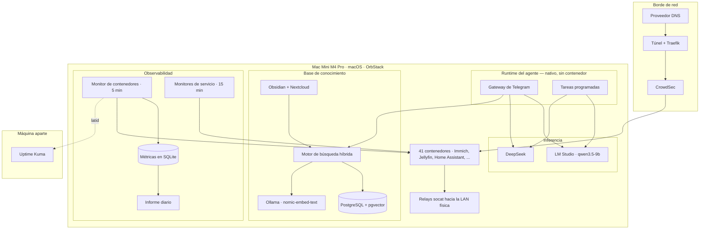
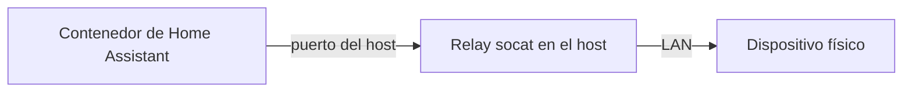

# Arquitectura

## Primero, las restricciones

Todas las decisiones no obvias de este sistema salen de cuatro restricciones. Conviene enunciarlas antes que los diagramas, porque si no varias elecciones parecen errores.

**Una sola máquina.** Un Mac Mini M4 Pro con 64 GB de memoria unificada. Sin clúster, sin failover, sin un segundo nodo *al que* hacer failover. La disponibilidad viene de recuperarse rápido, no de la redundancia.

**macOS, no Linux.** El runtime de contenedores es OrbStack, y los contenedores corren en una red virtualizada que no alcanza la LAN física directamente. Esto tiene una consecuencia grande, más abajo.

**Una casa, no una empresa.** El radio de impacto de una caída es que mi familia no pueda ver una película. Ese presupuesto permite automatización agresiva —un monitor tiene permiso para reiniciar cosas por su cuenta— pero también significa que nada aquí justifica el peso operativo de Kubernetes.

**Sensibilidad al coste.** La inferencia en la nube se paga por uso. Todo lo que corre programado, sin supervisión, decenas de veces al día, tiene que ir por defecto a un modelo local o se convierte en una factura que crece mientras nadie mira.

---

## Las capas

---

## El agente

Un agente conversacional accesible por Telegram, que corre como **proceso nativo y no dentro de un contenedor**. Es deliberado: gestiona el runtime de contenedores, y meterlo dentro de aquello que gestiona crea un bucle en el que no puede reiniciarse a sí mismo.

Hace tres tipos de trabajo: peticiones interactivas, tareas programadas, y una pasada nocturna que compacta el historial de conversación en notas duraderas.

### Enrutado de modelos

Cada petición va a uno de los dos backends según su complejidad, no según preferencia:

| Carga de trabajo | Backend | Por qué |
| --- | --- | --- |
| Chat interactivo | DeepSeek | Con un humano esperando, manda la calidad |
| Tareas de una sola tool | `qwen3.5-9b` en LM Studio | Corre sin supervisión y a menudo; el coste debe ser cero |
| Tareas multi-tool | DeepSeek | Ver abajo |

La tercera fila es un hallazgo, no una preferencia. `qwen3.5-9b` resuelve con fiabilidad una única llamada a herramienta con 64K de contexto, pero tras varias llamadas encadenadas pierde el hilo y **narra lo que piensa hacer en vez de devolver el resultado**. El fallo es silencioso: la tarea termina con código 0, la salida es prosa plausible, y no salta ninguna alerta. Las tareas multi-tool volvieron a DeepSeek por ese motivo y por ningún otro.

Es el tipo de límite que solo se encuentra dejando algo corriendo sin supervisión durante semanas.

---

## La base de conocimiento

Un RAG de búsqueda híbrida sobre unos 2.000 documentos que vienen de dos fuentes: un vault de Obsidian y una instancia de Nextcloud.

**La recuperación es híbrida por diseño.** La búsqueda vectorial densa (HNSW sobre pgvector) corre en paralelo a la búsqueda léxica (full-text `tsvector` de PostgreSQL, rankeada con BM25), y los dos conjuntos de resultados se combinan con reciprocal rank fusion.

Ninguna de las dos bastaba por separado. La vectorial maneja bien la paráfrasis y la similitud conceptual, pero se le escapan los identificadores exactos —el nombre de un contenedor, un código de error, un número de puerto—, que es justo de lo que suele ir una pregunta operativa. La léxica los clava y falla con cualquier cosa formulada distinto de como está en el origen.

**Los embeddings corren en local** con Ollama sobre `nomic-embed-text` (768 dimensiones), en la misma máquina. El corpus contiene datos privados, lo que descartó las APIs de embeddings de terceros antes de evaluar ninguna. Eso limita la elección de modelo a lo que quepa en memoria junto con todo lo demás: un coste real, pagado a conciencia.

El reindexado es incremental y corre cada noche, recorriendo ambas fuentes y re-embebiendo solo lo que ha cambiado.

Las dos fuentes se comportan de forma muy distinta, y eso condiciona el pipeline. El vault de Obsidian es pequeño, densamente enlazado y escrito para ser leído: produce pocos chunks por documento y responde bien a preguntas conceptuales. Nextcloud es lo contrario: documentos largos, sin estructura que aprovechar, y el grueso del recuento de chunks. **La mayor parte del corpus por volumen vive ahí, y la mayor parte de las respuestas útiles salen del vault.**

---

## La parte genuinamente rara: los relays

Esto es la consecuencia de correr contenedores sobre macOS.

Home Assistant corre en un contenedor. Su función entera es hablar con dispositivos físicos de la LAN, con varios protocolos y transportes distintos. **No puede alcanzar ninguno.** La red de contenedores está virtualizada y aislada de la red física.

La solución son nueve relays `socat` corriendo de forma nativa en el host, cada uno reenviando un puerto del host a un dispositivo de la LAN. El contenedor habla con el host; el host habla con el dispositivo.

Funciona, y es frágil de una forma interesante: **cada relay es un punto de fallo independiente e invisible desde dentro del contenedor.** Cuando un relay muere, la integración deja de reportar y la plataforma muestra el dispositivo como no disponible, sin ninguna pista de por qué.

Auditar esa cobertura produjo uno de los hallazgos de este proyecto: de los nueve relays, varios no estaban monitorizados en absoluto, y la línea del panel que informaba sobre ellos estaba contando otras cosas. Ver [Fiabilidad](case-studies/reliability.md).

---

## Observabilidad

Tres capas, cada una respondiendo a una pregunta distinta.

| Capa | Pregunta que responde | Dónde corre |
| --- | --- | --- |
| Monitor de contenedores, cada 5 min | ¿Está cada contenedor en pie, y qué consume? | En el host |
| Monitores de servicio, cada 15 min | ¿Funcionan de verdad las integraciones que dependen de él? | En el host |
| Uptime Kuma | ¿Está viva la máquina entera? | **En otra máquina** |

La tercera fila importa más de lo que parece. Todos los monitores locales comparten un modo de fallo: si la máquina muere, muere también aquello que te lo iba a contar. El observador externo es el único componente capaz de reportar el fallo total de todo lo demás.

Las métricas van a **SQLite, no a Prometheus.** Es una degradación deliberada. Esto es un nodo único, con intervalo de muestreo de cinco minutos y unas pocas decenas de series. SQLite significa ningún contenedor extra, ninguna configuración de scraping, ningún subsistema de retención que operar, y consultas en un lenguaje que ya conozco. Prometheus y Grafana son la respuesta correcta con diez nodos; con uno, son infraestructura que necesita su propia monitorización.

La retención es explícita y no una función de la base de datos: resolución completa durante 30 días, y después medias horarias guardadas indefinidamente. Detalles en [Fiabilidad](case-studies/reliability.md).

---

## Almacenamiento y recuperación

Dos discos NVMe: uno para datos en vivo, otro que recibe un snapshot nocturno más nueve volcados de base de datos.

La mitad interesante no es el backup, es la verificación. **Trece comprobaciones de integridad corren la mañana siguiente a cada backup e informan por Telegram tanto si pasan como si fallan.** Un backup sin verificar es una hipótesis, y el modo de fallo de los backups es silencioso: dejan de funcionar, y te enteras el peor día posible.

---

## Lo que falta a propósito

**Sin Kubernetes.** Un nodo. Su maquinaria de planificación, descubrimiento de servicios y actualizaciones progresivas resolvería problemas que este sistema no tiene, y añadiría un plano de control que a su vez necesita monitorización.

**Sin almacenamiento cloud para datos privados.** Se quedan en hardware que es mío. Esa es la razón del modelo de embeddings local y de buena parte de la carga operativa.

**Sin alta disponibilidad.** La recuperación es rápida y está ensayada; el uptime no está garantizado. Para una casa, el tiempo medio de recuperación es el número que merece la pena optimizar, y sale mucho más barato que el tiempo medio entre fallos.

**Sin secretos en el repositorio.** Las credenciales se cargan en tiempo de ejecución desde ficheros fuera del control de versiones. Esto no era cierto hasta hace poco — ver [Decisiones y errores](decisions.md).
