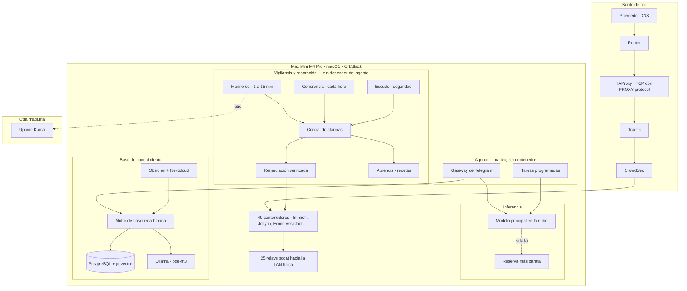
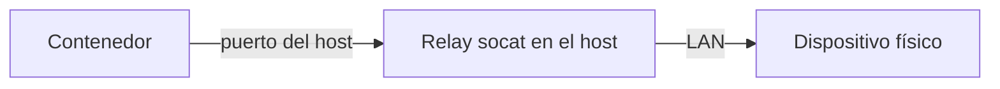

# Arquitectura

## Las restricciones

Todas las decisiones no obvias de este sistema salen de cuatro restricciones. Conviene enunciarlas antes que los diagramas, porque si no varias elecciones parecen errores de principiante.

### Una sola máquina

Un Mac Mini M4 Pro con 64 GB de memoria unificada. Sin clúster, sin un segundo nodo *al que* hacer failover.

La consecuencia práctica es que **la disponibilidad no viene de la redundancia sino de la velocidad de recuperación**. No hay forma de sobrevivir a que esta máquina se apague; lo único que se puede optimizar es cuánto se tarda en volver, y cuánto se pierde por el camino. De ahí que el esfuerzo esté puesto en backups verificados, en recuperación automática y en provocar averías a propósito para medir esa recuperación, y no en alta disponibilidad.

También significa que cualquier cosa que instale compite por la misma memoria. El modelo de embeddings local, los 49 contenedores, PostgreSQL y un detector de objetos para las cámaras conviven en los mismos 64 GB. Durante meses también convivió un modelo de lenguaje local de 9B; salió de la máquina cuando quedó claro que no compensaba (está contado más abajo).

### macOS

El runtime de contenedores es OrbStack. Los contenedores corren en una red virtualizada que **no alcanza la LAN física directamente**.

En Linux con `network_mode: host` esto no sería un problema: el contenedor comparte la pila de red del anfitrión y ve la red local igual que cualquier proceso. En macOS no existe ese modo real, porque los contenedores viven dentro de una máquina virtual ligera con su propia red.

Para casi todo da igual: un servidor web solo necesita que le lleguen peticiones. Para la domótica y las cámaras es determinante, porque su función entera consiste en hablar con aparatos que están al otro lado de esa frontera. Es la restricción que genera la parte más rara de este sistema, y tiene su propia sección más abajo.

### Hogar

El radio de impacto de una caída es que mi familia no pueda ver una película o que las luces no se enciendan solas.

Ese presupuesto de riesgo compra dos cosas. Permite **automatización agresiva**: el sistema reinicia contenedores por su cuenta, incluidas las bases de datos y el gestor de contraseñas, algo que en producción exigiría bastante más ceremonia. Y descarta de plano cualquier tecnología cuyo coste operativo solo se justifica a escala.

Es la razón por la que aquí no hay Kubernetes, ni Prometheus, ni un sistema de colas. No es que sean malas herramientas: es que cada una traería consigo un sistema que a su vez hay que operar, actualizar y monitorizar, para resolver problemas que un solo nodo no tiene.

### Sensibilidad al coste

La inferencia en la nube se paga por token. Un agente interactivo al que le escribes veinte veces al día tiene un coste despreciable. Una tarea programada que corre cada hora, sin supervisión, arrastrando contexto y haciendo varias llamadas a herramientas, no.

La primera respuesta de diseño fue mandar todo lo automático a un modelo local. No sobrevivió al contacto con la realidad: un modelo pequeño falla en silencio en las tareas largas, y el ahorro no compensaba el tiempo perdido en descubrirlo. Hoy la respuesta es otra: **lo automático que no necesita un modelo no lo usa** (el informe diario, la agenda, la monitorización y las copias son código determinista), y lo que sí lo necesita va a un modelo en la nube con una reserva más barata, y con el gasto de cada llamada registrado.

---

## Las capas

---

## Los contenedores

El diagrama de arriba colapsa la mayoría de esto en una sola caja. Desplegado,
es bastante más heterogéneo de lo que sugiere un rectángulo — útil de ver de
un vistazo cuánto convive en una sola máquina.

### Red y borde

| Contenedor | Qué hace |
| --- | --- |
| Traefik | Proxy inverso. Enruta el tráfico hacia el contenedor correcto por dominio, con middlewares de acceso por origen |
| CrowdSec | Detecta patrones de abuso en los logs de Traefik y alimenta un bloqueo compartido |
| Pangolin | Túneles para exponer servicios concretos sin abrir puertos adicionales |
| Gerbil | El extremo del túnel que habla con Pangolin |
| DDNS a Cloudflare | Mantiene el registro DNS apuntando a la IP pública, que cambia |

Delante de todos ellos, fuera de Docker, corre **HAProxy** en el propio Mac: recibe el puerto 443 y se lo pasa a Traefik con *PROXY protocol*, para que Traefik y CrowdSec vean la IP real del cliente en lugar de la del puente de red de OrbStack. Sin eso, CrowdSec bloquearía —o perdonaría— a todo el mundo a la vez.

### Domótica

| Contenedor | Qué hace |
| --- | --- |
| Home Assistant | La plataforma de domótica en sí — automatizaciones, integraciones, panel de control |
| Zigbee2MQTT | Puente entre el coordinador Zigbee y el resto del sistema, vía MQTT |
| Matter Server | Soporte del protocolo Matter para los dispositivos que lo hablan |
| Mosquitto | El broker MQTT sobre el que se comunican Home Assistant y Zigbee2MQTT |
| Frigate | Grabador de las cámaras con detección de personas; también da la imagen en directo a Home Assistant |

### Multimedia

| Contenedor | Qué hace |
| --- | --- |
| Jellyfin (×4) | Vídeo, música, podcasts y una instancia aparte para un familiar, cada una con su biblioteca y sus usuarios |
| Audiobookshelf | Audiolibros, con seguimiento de progreso |
| qBittorrent y Jackett | Cliente de descargas y su buscador |
| Proveedor de tokens de YouTube | Auxiliar para las descargas de podcasts |

### Productividad y datos

| Contenedor | Qué hace |
| --- | --- |
| Nextcloud | Ficheros, calendario, tareas — el servidor de colaboración |
| Base de datos de Nextcloud | MariaDB dedicada a esa instancia |
| Caché de Nextcloud | Redis para sesiones y caché de la aplicación |
| Vaultwarden | Gestor de contraseñas, compatible con el protocolo de Bitwarden |
| CouchDB + puente LiveSync | Sincronizan el vault de notas entre el servidor y los dispositivos |
| Stirling PDF | Herramientas de manipulación de PDF con interfaz web |
| n8n | Automatización de flujos de trabajo entre servicios |

### Fotos

| Contenedor | Qué hace |
| --- | --- |
| Immich (servidor) | Gestión y backup de fotos y vídeo desde el móvil |
| Immich (aprendizaje automático) | Reconocimiento facial y de objetos sobre la biblioteca |
| Immich (base de datos) | PostgreSQL con la extensión vectorial que usa el reconocimiento |
| Immich (caché) | Redis para tareas en cola y caché |

### Búsqueda, conocimiento e IA

| Contenedor | Qué hace |
| --- | --- |
| Motor de búsqueda híbrida | El servicio descrito más abajo; el agente lo usa como servidor MCP |
| Base de datos del motor | PostgreSQL con pgvector, dedicada a los embeddings |
| Open WebUI | Interfaz de chat para hablar directamente con los modelos |

### Portales propios

| Contenedor | Qué hace |
| --- | --- |
| Monitoring | El panel de vigilancia: la central de alarmas, la remediación, la antifragilidad, la coherencia y las tareas programadas |
| Ticketing | La única lista de pendientes del homelab |
| Página de inicio | Accesos directos a todo lo demás |
| Escudo | El portal de seguridad: exposición, accesos, red local, parches |
| Cine, running, energía | Portales de uso diario, con sus propios datos |
| Escaparate | La única página pública: un resumen del homelab con cifras en vivo |

Todos comparten el mismo login por portal y, salvo el escaparate, solo responden desde la red de casa.

### Monitorización

| Contenedor | Qué hace |
| --- | --- |
| Beszel (+ agente y proxy del socket de Docker) | CPU, memoria y disco de las máquinas de la red, con panel propio |
| Speedtest Tracker | Mide la conexión a intervalos regulares y guarda el histórico |
| Servicio de alertas | Recibe los avisos del observador externo y los reenvía a Telegram |

### Creatividad

| Contenedor | Qué hace |
| --- | --- |
| Excalidraw | Pizarra para diagramas a mano alzada |
| Minipaint | Editor de imágenes ligero, en el navegador |

---

## El agente

### Qué es y por qué no está en un contenedor

Un agente conversacional accesible desde Telegram, construido sobre Hermes Agent. Le escribes como a una persona, y puede responder preguntas, consultar la base de conocimiento, o ejecutar acciones sobre la infraestructura y la casa.

Corre como **proceso nativo del sistema operativo, no dentro de un contenedor**. El agente gestiona el runtime de contenedores: entre sus herramientas están listar contenedores, leer sus logs y reiniciarlos.

### Lo que no hace

La decisión de diseño más importante sobre el agente es negativa: **nada esencial depende de él**. La vigilancia, la reparación, las copias, la recuperación tras un corte de luz y el informe diario son código determinista que corre por su cuenta. Si el agente se cae, se pierde la conversación y poco más.

Esto no fue así desde el principio. La primera versión del informe diario, de la agenda y de parte de la monitorización eran tareas del agente, y cada fallo del agente —un modelo caído, una clave sin saldo, una actualización que rompía algo— se llevaba por delante cosas que no tenían nada que ver con él.

### Las tres clases de trabajo

**Interactivo.** Preguntas y comandos por Telegram. Aquí hay un humano esperando una respuesta, y la latencia y la calidad importan.

**Programado.** Pocas tareas, y solo las que de verdad necesitan un modelo: un digest de noticias y el mantenimiento de su propia memoria. El resto de lo programado salió del agente.

**Consolidación de memoria.** Una pasada nocturna que compacta el historial de conversación en notas duraderas, para que el agente no arrastre indefinidamente todo lo que se ha dicho.

Además, el sistema lo **despierta** cuando hace falta criterio: tras un corte de luz recibe el informe de recuperación para revisar lo que quedó pendiente, y cuando una avería no tiene receta conocida, el Aprendiz le pide que la arregle (ver [Fiabilidad](case-studies/reliability.md)).

### Quién puede reiniciar qué

Durante meses los contenedores estuvieron clasificados: un grupo —bases de datos, gestor de contraseñas, domótica, proxy inverso— estaba marcado como crítico, y **el sistema podía alertar sobre ellos pero no tocarlos**. El razonamiento era que un reinicio a ciegas de una base de datos con escrituras puede convertir una incidencia menor en corrupción de datos.

Esa frontera se movió. Lo que la justificaba era el *a ciegas*, y dejó de serlo: hoy cada reinicio se decide con la evidencia del contenedor delante, se **verifica** después (no basta con que el comando devuelva 0) y tiene un cortacircuitos si se repite. Con eso, esperar a que un humano lea el aviso resultó más arriesgado que reiniciar. Los críticos siguen existiendo, pero como prioridad, no como prohibición.

### Modelos

| Carga de trabajo | Backend | Por qué |
| --- | --- | --- |
| Chat interactivo y tareas del agente | Modelo principal en la nube | Con un humano esperando, manda la calidad |
| Si el principal falla (caída, clave, saldo) | Reserva más barata, con aviso | El agente sigue contestando mientras se arregla |
| Decidir si una acción de reparación aplica | El mismo par, con el gasto por llamada registrado | Ver [Fiabilidad](case-studies/reliability.md) |

El cambio a la reserva es automático y avisa por Telegram: un agente que cambia de modelo en silencio es otro de esos sistemas que reportan verde sin estarlo.

### El modelo local que se fue

Durante meses las tareas programadas corrieron sobre `qwen3.5-9b` en local, por coste. De esa época queda el hallazgo más útil sobre modelos pequeños de todo el proyecto.

`qwen3.5-9b` resuelve con fiabilidad **una única llamada a herramienta**. Le pides el uso de disco, invoca la herramienta, recibe el resultado, redacta la respuesta. Perfecto.

Cuando la tarea requiere **varias llamadas encadenadas** —consultar el estado, decidir qué mirar después, consultar otra cosa, y entonces resumir— el modelo pierde el hilo a partir de la tercera o cuarta y hace algo muy concreto: **narra lo que piensa hacer en lugar de hacerlo**. La salida es del tipo *"ahora consultaré el estado de los contenedores y prepararé un resumen"*, en vez del resumen.

Lo insidioso es el modo de fallo. La tarea **termina con código de salida 0**. No hay excepción, no hay timeout, no hay error en ningún log. La salida es prosa gramaticalmente perfecta y plausible. Si el mensaje llega a Telegram a las tres de la mañana y lo lees por encima, parece que funcionó.

Primero las tareas multi-tool volvieron a la nube. Después, las de una sola herramienta dejaron de necesitar un modelo: eran informes que se podían escribir con código. Al final el modelo local no tenía trabajo, y liberó la memoria que ocupaba. La conclusión operativa sigue en pie: **un modelo pequeño degrada de forma silenciosa en lugar de fallar de forma ruidosa**, y eso solo se encuentra dejando algo corriendo sin supervisión durante semanas.

---

## La base de conocimiento

### Qué indexa

Un RAG de búsqueda híbrida sobre unas 2.000 páginas que vienen de dos fuentes muy distintas:

- Un **vault de Obsidian**: notas personales en markdown, densamente enlazadas entre sí. Incluye toda la documentación operativa del homelab.
- Una instancia de **Nextcloud**: documentos ofimáticos, PDFs, hojas de cálculo, y todo lo que uno acumula en un servidor de ficheros. Las carpetas con datos especialmente sensibles se excluyen a propósito.

Total actual: **unas 2.080 páginas y 11.200 chunks**, todos con embedding.

El agente lo consulta a través de un servidor MCP, desde Telegram con comandos dedicados y también internamente cuando una pregunta requiere contexto que no está en la conversación.

### Por qué la recuperación es híbrida

Corren dos búsquedas en paralelo sobre el mismo sistema:

**Búsqueda vectorial densa.** Cada chunk está representado por un vector de 1.024 dimensiones, indexado con HNSW sobre pgvector. La consulta se convierte en un vector y se buscan los chunks más cercanos por similitud de coseno. Captura significado: encuentra documentos que hablan de lo mismo aunque no compartan una sola palabra.

**Búsqueda léxica.** Full-text de PostgreSQL con `tsvector`, rankeada con BM25. Busca las palabras literales de la consulta, ponderando por frecuencia y rareza.

Los dos conjuntos de resultados se combinan mediante **reciprocal rank fusion**: en lugar de intentar comparar puntuaciones que están en escalas incompatibles, se usa solo la *posición* de cada documento en cada lista. Un documento que sale tercero en una y quinto en la otra puntúa mejor que uno que sale primero en una y no aparece en la otra. Es un método sencillo y sorprendentemente robusto precisamente porque ignora las puntuaciones.

**Ninguna de las dos bastaba por separado**, y el motivo es muy concreto en un corpus operativo. La vectorial maneja bien la paráfrasis, pero se le escapan los identificadores exactos: el nombre de un contenedor, un código de error, un número de puerto. Y esos identificadores son justo de lo que va una pregunta operativa. Preguntar por `nextcloud_redis` a un buscador semántico devuelve documentos sobre Redis y sobre Nextcloud, no el que menciona ese contenedor concreto.

La léxica clava esos casos y falla estrepitosamente con cualquier cosa formulada de otra manera que en el original.

### Embeddings locales

Los embeddings se generan con Ollama sobre `bge-m3`, 1.024 dimensiones, en la misma máquina. Sustituyó a `nomic-embed-text` (768 dimensiones), y el cambio obligó a reembeber el corpus entero.

**La razón de que sean locales es que el corpus contiene datos privados.** Enviar notas personales y documentos familiares a una API de embeddings de terceros quedó descartado antes de evaluar ninguna, así que la decisión no se tomó por calidad ni por precio.

El coste es real y merece enunciarse en lugar de esconderlo. Limita la elección de modelo a lo que quepa en memoria junto con todo lo demás, lo que en la práctica significa modelos más pequeños que los de las APIs comerciales. Y hace que el reindexado de todo el corpus sea una operación que se mide en horas y no en minutos.

### Reindexado incremental

Corre cada noche. Recorre ambas fuentes, detecta qué ha cambiado desde la última pasada, y **solo vuelve a embeber lo que se ha modificado**. Reprocesar 11.000 chunks cada noche sería absurdo cuando en un día normal cambian veinte.

El reindexado **falla en voz alta**: si una fuente devuelve cero documentos, o no responde, termina con error en lugar de dar por buena una pasada vacía. Durante un tiempo no lo hacía, y una fuente caída se convertía en un índice que envejecía sin que nada lo dijera.

### Las dos fuentes se comportan de forma distinta

Y eso condiciona el pipeline más de lo que uno espera al montarlo.

El vault de Obsidian es pequeño, densamente enlazado y **escrito para ser leído**: tiene títulos, estructura, y las notas se referencian entre sí. Produce pocos chunks por documento y responde muy bien a preguntas conceptuales, porque el propio texto ya está organizado por ideas. Sus etiquetas se inyectan como texto antes de indexar, para que cuenten en la búsqueda.

Nextcloud es lo contrario: documentos largos, sin estructura aprovechable, muchos de ellos PDFs y hojas de cálculo de los que hay que extraer el texto. Aporta el grueso del recuento de páginas, y necesita límites —tamaño por fichero, filas por hoja, tiempo por documento— para que un solo fichero patológico no bloquee la pasada entera.

El resultado es asimétrico y vale la pena tenerlo presente: **la mayor parte del corpus por volumen vive en Nextcloud, y la mayor parte de las respuestas útiles salen del vault.**

---

## La parte genuinamente rara: los relays

### El problema

Home Assistant corre en un contenedor. Su función entera es hablar con dispositivos físicos de la LAN, con varios protocolos y transportes distintos — algunos TCP, alguno UDP, cada uno con su puerto. Lo mismo le pasa a Frigate con las cámaras.

**No pueden alcanzar ninguno.** La red de contenedores está virtualizada y aislada de la red física, por lo que se explicó en las restricciones.

Sin resolver esto, la plataforma de domótica no controla absolutamente nada.

### La solución

**25 relays `socat`** corriendo de forma **nativa en el host**, fuera de Docker. Cada uno escucha en un puerto del anfitrión y reenvía todo el tráfico a la dirección y puerto de un dispositivo concreto de la LAN.

El contenedor se configura para hablar con el host en ese puerto. El host habla con el aparato. Para el contenedor es transparente: cree que está hablando con el dispositivo.

Se gestionan como servicios del sistema, para que se levanten solos al arrancar la máquina y launchd los relance si mueren.

### Por qué es frágil

Funciona bien y es estable. El problema es otro: **cada relay es un punto de fallo independiente e invisible desde dentro del contenedor.**

Cuando un relay muere, Home Assistant no recibe ningún error útil. Simplemente deja de recibir datos de esos dispositivos y los muestra como no disponibles, exactamente igual que si el aparato estuviera apagado o desconectado de la wifi. No hay nada en los logs del contenedor que apunte al relay, porque desde su punto de vista el relay no existe.

El diagnóstico correcto —comprobar si el proceso del relay sigue vivo en el anfitrión— no es donde nadie mira primero.

Cuando eran nueve, auditar su cobertura produjo uno de los hallazgos de este proyecto: varios no estaban monitorizados en absoluto, y la línea del informe diario que decía informar sobre ellos estaba contando otras cosas. Hoy un comprobador recorre los 25 cada pocos minutos —que el proceso viva y que el puerto responda— y cualquier fallo llega a la central de alarmas. Está desarrollado en [Fiabilidad](case-studies/reliability.md).

---

## Vigilancia

### Capas, y una regla

| Capa | Pregunta que responde | Dónde corre | Cada |
| --- | --- | --- | --- |
| Monitores | ¿Está cada pieza en pie y haciendo su trabajo? | En el host | 1 a 15 min |
| Central de alarmas | ¿Qué está mal ahora mismo, en un solo sitio? | En el host | continuo |
| Remediación y Aprendiz | ¿Se puede arreglar sin que nadie haga nada? | En el host | 1 a 5 min |
| Coherencia | ¿Cuadran entre sí las listas que deberían cuadrar? | En el host | cada hora |
| Escudo | ¿Qué está expuesto, quién intenta entrar, qué ha cambiado? | En el host | 30 min |
| Uptime Kuma | ¿Está viva la máquina entera? | **En otra máquina** | continuo |
| Vigilante del disco de datos | ¿Sigue montado el disco donde vive todo lo demás? | **En el disco del sistema** | 60 s |

La regla que atraviesa todas las capas: **nada de esto depende del agente**. Son scripts deterministas, cada uno con su latido, y cada latido vigilado.

Los monitores no comprueban solo que un contenedor esté corriendo, sino que **el servicio hace su trabajo**: que la API de domótica responde, que el puente Zigbee está conectado, que los sensores siguen reportando, que las baterías no están agotadas, que los dos resolvers DNS contestan, que el conjunto de discos de backup sigue completo. Un contenedor puede estar perfectamente en pie y haber perdido la conexión con la mitad de la casa.

**Todos los monitores locales comparten un modo de fallo**: si la máquina se apaga, se cuelga, o pierde la red, se apaga también aquello que iba a avisarte. El observador externo, corriendo en hardware distinto, es el único componente capaz de reportar el fallo total de todo lo demás. Y tiene que avisar **sin pasar por el Mac**: durante meses su notificación de Telegram salía a través de un servicio que vivía en el propio Mac, así que con el Mac apagado el único aviso posible no llegaba. Se descubrió provocando un apagón a propósito.

Lo mismo vale para el disco de datos: el vigilante que comprueba que sigue montado vive en el disco del sistema, porque un vigilante guardado en el disco que vigila desaparece con él.

### ¿Quién vigila al que vigila?

No tiene respuesta limpia, pero sí respuestas parciales: el observador externo recibe un latido del Mac y el Mac comprueba que el observador responde; el canal de Telegram tiene su propio latido; y cada monitor deja un latido que la central de alarmas vigila, de modo que un monitor que deja de pasar es una alarma, no un silencio.

### Cada monitor, uno por uno

| Qué hace | Cada |
| --- | --- |
| Comprueba que el disco de datos sigue montado y responde | 60 s |
| Vigila los contenedores: en pie, consumo, salud real cuando la tienen declarada | 5 min |
| Decide y ejecuta la remediación de contenedores y servicios | 5 min |
| Comprueba los relays, los resolvers DNS y el conjunto de discos de backup | 5 min |
| Envía un latido al observador externo | 5 min |
| Revisa las integraciones de domótica: API, puente Zigbee, sensores, baterías, cámaras | 15 min |
| Revisa la seguridad: puertos, accesos, red local, parches | 30 min |
| Cruza las listas que deberían cuadrar (proxy, portales, latidos, servicios) | cada hora |
| Copia el disco de datos y los volcados de las bases de datos | diaria, 02:00 |
| Hace una instantánea con historial de toda la copia | diaria, 04:15 |
| Reindexa la base de conocimiento | diaria, 04:45 |
| Verifica las copias de la noche — diecisiete comprobaciones | diaria, 06:30 |
| Envía el informe de estado del día | diaria, 09:00 |
| Agrega y purga las métricas antiguas | semanal |
| Actualiza las imágenes de los contenedores, con rollback automático si alguna no arranca | semanal |

### Alertas solo en el cambio de estado

Un detalle de diseño que condiciona el comportamiento entero: los monitores guardan el último estado conocido de cada elemento en un fichero, y **solo notifican cuando ese estado cambia**.

Sin eso, un contenedor caído durante un día generaría 288 mensajes idénticos. Con eso, genera uno cuando cae y otro cuando se recupera.

Tiene una contrapartida que tardé meses en ver: un problema que se auto-resuelve una y otra vez produce una secuencia de mensajes de recuperación aislados, y esos no disparan ninguna alarma mental. Es exactamente el mecanismo por el que 49 reinicios del mismo contenedor pasaron desapercibidos.

Y otra que solo aparece al provocar averías: tras un arranque, o tras un corte de Internet, muchos monitores ven a la vez cosas que todavía están arrancando. Sin una ventana de gracia, cada corte de luz producía decenas de avisos de cosas que se arreglaban solas dos minutos después. Ahora las caídas nuevas se **retienen** durante el arranque y durante un corte de Internet, y solo se avisa de las que siguen ahí cuando pasa la ventana.

### Ventana de mantenimiento

Existe un comando que silencia todas las alertas durante un número de minutos. Escribe una marca de tiempo en un fichero y todos los monitores lo consultan antes de notificar.

Es lo que permite actualizar imágenes o reiniciar cosas a mano sin recibir veinte mensajes. Las métricas se siguen registrando durante la ventana — un incidente silenciado sigue siendo un dato.

### SQLite

Las métricas van a un fichero SQLite. Es una degradación deliberada respecto al estándar del sector, y conviene argumentarla porque parece pereza.

Este es **un nodo**, con intervalo de muestreo de cinco minutos y unas pocas decenas de series. En ese régimen, SQLite significa: ningún contenedor extra que mantener, ninguna configuración de scraping, ningún subsistema de retención que aprender a operar, ningún lenguaje de consulta nuevo, y un fichero que entra en el backup nocturno sin hacer nada especial.

Prometheus y Grafana son la respuesta correcta con diez nodos, cuando necesitas descubrimiento automático de objetivos, o reglas de alerta expresadas sobre las propias métricas. Con uno, son dos servicios más que a su vez necesitan monitorización, para resolver un problema que cabe en un fichero de pocos megas.

**La condición de reversión está escrita**: en torno a diez nodos, o la primera vez que quiera alertas calculadas sobre las series en lugar de sobre las comprobaciones en crudo.

La retención es explícita y no una función de la base de datos: resolución completa durante 30 días, y después medias horarias guardadas indefinidamente. El diseño y sus dos garantías de seguridad están en [Fiabilidad](case-studies/reliability.md).

---

## Almacenamiento y recuperación

### La topología

Cuatro volúmenes con papeles bien separados.

**Disco interno del Mac Mini — ~500 GB.** El sistema operativo y las aplicaciones, y dos cosas que tienen que sobrevivir a que caiga el disco de datos: el vigilante de ese disco y los logs de las copias. **Ningún dato del homelab vive aquí**, ni siquiera los volúmenes de los contenedores.

**NVMe de datos — 2 TB, en caja externa.** Todo lo que está en uso:

- Los volúmenes de los 49 contenedores: bases de datos, configuración y estado de Immich, Jellyfin, Nextcloud, Vaultwarden, la domótica y el resto
- La biblioteca de fotos y la de audio
- El vault de notas
- El propio proyecto del homelab: scripts, documentación, ficheros de estado y la base de datos de métricas

**Disco de 10 TB.** Dos cosas que no se parecen:

- La **copia diaria** del NVMe de datos, más la configuración del agente
- La **biblioteca de vídeo**, que vive aquí directamente: es el original, no una copia de nada

**Conjunto de backup — 11 TB, dos discos concatenados.** La copia con historial de todo el disco de 10 TB: una instantánea por día, donde lo que no cambió son enlaces duros y solo ocupa lo nuevo. Se guardan tres diarias, dos semanales y una mensual.

### Del espejo a dos copias

La primera versión tenía el backup en un espejo RAID 1 de dos discos de 5 TB, y la videoteca vivía en ese mismo espejo **sin copia en ningún otro sitio**: su única protección era que muriera un solo disco a la vez, no un borrado accidental.

El espejo falló exactamente como falla un espejo. Uno de los discos, conectado por USB, cayó del conjunto; se reconstruyó, y el mismo día volvió a quedar degradado. **Durante once días el volumen siguió funcionando con un solo disco.** El comprobador del RAID avisó por Telegram y lo dejó registrado cada cinco minutos; nadie lo leyó, porque llegó el mismo día en que el problema se daba por resuelto. Un aviso que no se lee es la misma lección que los 49 reinicios, por otro camino.

El disco se retiró, el espacio se quedó corto, y la pregunta que guió el nuevo reparto fue la de siempre: **si esto desaparece, ¿se puede volver a conseguir?** La respuesta llevó a renunciar al espejo y tener **dos copias independientes**: el disco de 10 TB guarda la copia de la noche y el original de la videoteca, y el conjunto de backup guarda el historial de todo lo anterior —vídeo incluido—.

El conjunto de backup es una concatenación, no un espejo: si falla cualquiera de sus dos discos se pierde **toda esa copia**. Es un riesgo asumido y escrito, porque el original sigue en el disco de 10 TB, y un comprobador avisa en cuanto el conjunto deja de estar completo. Un componente cuyo diseño consiste en tolerar —o asumir— un fallo necesita alguien que vigile si el fallo ha llegado.

**Los datos en vivo no están en el disco de sistema.** Eso permite reinstalar macOS, o sustituir la máquina entera, sin tocar nada del homelab: los volúmenes de los contenedores están en un disco aparte que se conecta al hardware nuevo.

### Qué se copia

Cada noche a las 02:00: **el disco de datos entero**, la configuración del agente, y **un volcado coherente de cada base de datos**. A las 04:15, la instantánea con historial.

Las tres tareas de la noche —copia, instantánea y verificación— van **encadenadas**: si una no llega a hacerse (un corte de luz, un disco desconectado), el guion de arranque la relanza al volver, en orden.

### El problema de las bases de datos abiertas

Copiar los ficheros de una base de datos que está escribiendo produce una copia que puede no ser restaurable: se captura la mitad de una transacción, o un índice que ya no corresponde a los datos.

El backup lo resuelve en dos pasos, y el orden importa:

**Antes de copiar nada**, genera un volcado coherente de cada base de datos. Para las SQLite usa el comando `.backup` del propio motor, que produce un fichero consistente aunque haya escrituras en curso, con reintentos y una comprobación de que el volcado no sale vacío ni dañado; para las PostgreSQL y MariaDB, un volcado SQL completo.

**Después copia**, excluyendo los ficheros vivos de esas mismas bases de datos. Los directorios de datos de PostgreSQL y MariaDB, los ficheros WAL, los journals y los `-shm`/`-wal` de SQLite **quedan fuera de la copia a propósito**: son justamente los que no se pueden copiar en caliente, y ya están representados por su volcado.

También se excluyen cachés, transcodificaciones de vídeo, sockets y ficheros de proceso. Nada de eso es un dato: es estado reconstruible que solo haría el backup más lento y más grande.

Es un detalle de fontanería y es donde se decide si un backup sirve. Una copia que incluye el directorio vivo de una base de datos parece completa —pesa lo que tiene que pesar, los ficheros están— y no arranca al restaurarla.

### La parte que de verdad importa

La mitad interesante no es el backup, es la verificación. Y la otra mitad interesante es la restauración.

**Diecisiete comprobaciones corren a las 06:30**, y el informe llega por Telegram **tanto si pasan como si fallan**. Comprueban que cada volcado existe, es de esta noche y no es sospechosamente pequeño; que los datos llegaron de verdad al disco de destino; que el log de la copia termina con su resumen; y que la instantánea con historial está completa, tiene lo que debe y la poda está al día.

El motivo de que esto exista es que **el modo de fallo de los backups es silencioso**. No dejan de funcionar con un estruendo: dejan de funcionar, y todo lo demás sigue igual, y te enteras el día que necesitas restaurar. Un backup sin verificar no es una copia de seguridad, es una hipótesis.

Que el informe llegue también cuando todo va bien es intencionado: si solo llegara al fallar, la ausencia de mensajes sería ambigua entre "todo correcto" y "el verificador también está roto".

Pero una verificación solo dice que la copia está ahí. Para saber si **sirve**, hay ensayos de restauración guionizados para los servicios que más importan —gestor de contraseñas, domótica, fotos y ficheros—: cada uno levanta la copia de anoche aparte, sin red y sin tocar el servicio real, comprueba que arranca y que tiene lo que debe, y se limpia solo. El primero que se hizo encontró que la copia del gestor de contraseñas era íntegra, pero que nadie sabía cómo descifrarla sin improvisar.

---

## Lo que falta a propósito

**Sin Kubernetes.** Un nodo. Su maquinaria de planificación, descubrimiento de servicios, actualizaciones progresivas y auto-escalado resuelve problemas que aparecen cuando tienes muchas máquinas y muchos equipos. Aquí no hay ninguno de esos problemas, y a cambio traería un plano de control que a su vez hay que actualizar, respaldar y monitorizar. La complejidad tiene que pagarse a sí misma.

**Sin almacenamiento cloud para datos privados.** Fotos, documentos y notas se quedan en hardware que es mío. Es la razón del modelo de embeddings local, de buena parte de la carga operativa, y de que exista este sistema de backups en primer lugar. Es una decisión de valores más que técnica, y tiene un precio que se paga en trabajo.

**Sin alta disponibilidad, y sin SAI.** La recuperación es rápida y está ensayada —se provocan cortes de luz a propósito para medirla—; el uptime no está garantizado. Para una casa, el tiempo medio de recuperación es el número que merece la pena optimizar, y sale órdenes de magnitud más barato que el tiempo medio entre fallos.

**Sin secretos en el repositorio.** Las credenciales se cargan en tiempo de ejecución desde ficheros fuera del control de versiones, con permisos restrictivos, y con un escaneo automático que impide commitear un token por accidente. Esto **no fue cierto desde el principio**: había credenciales escritas a fuego en seis scripts. Está contado en [Decisiones y errores](decisions.md) y en [Auditoría de seguridad](case-studies/security.md).
