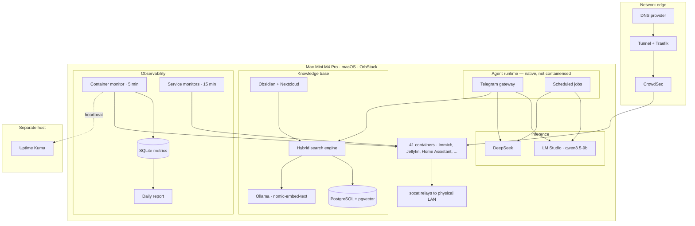

# Architecture

## Constraints first

Every non-obvious decision in this system follows from four constraints. They are worth stating before the diagrams, because otherwise several choices look like mistakes.

**One machine.** A single Mac Mini M4 Pro with 64 GB of unified memory. No cluster, no failover, no second node to fail over *to*. Availability comes from fast recovery, not redundancy.

**macOS, not Linux.** The container runtime is OrbStack, and containers run in a virtualised network that cannot reach the physical LAN directly. This has a large downstream consequence, covered below.

**A household, not a company.** The blast radius of an outage is my family being unable to watch a film. That budget buys aggressive automation — a monitor is allowed to restart things on its own — but it also means nothing here justifies the operational weight of Kubernetes.

**Cost sensitivity.** Cloud inference is metered. Anything that runs on a schedule, unattended, dozens of times a day, must default to a local model or it becomes a bill that grows while nobody is looking.

---

## The layers

---

## The agent

A conversational agent reachable over Telegram, running as a **native process rather than a container**. That is deliberate: it manages the container runtime, and putting it inside the thing it manages creates a dependency loop where the agent cannot restart itself.

It handles three kinds of work: interactive requests, scheduled jobs, and a nightly pass that compacts conversation history into durable notes.

### Model routing

Requests go to one of two backends by complexity, not by preference:

| Workload | Backend | Why |
| --- | --- | --- |
| Interactive chat | DeepSeek | Quality matters when a human is waiting |
| Single-tool scheduled jobs | `qwen3.5-9b` via LM Studio | Runs unattended and often; cost must be zero |
| Multi-tool scheduled jobs | DeepSeek | See below |

The third row is a finding, not a preference. `qwen3.5-9b` handles a single tool call reliably at 64K context, but after several sequential calls it loses the thread and **narrates what it intends to do instead of returning the result**. The failure is quiet: the job exits successfully, the output is plausible prose, and nothing alerts. Multi-tool jobs went back to DeepSeek for that reason and no other.

That is the kind of limit you only find by running something unattended for weeks.

---

## The knowledge base

A hybrid-search RAG over roughly 2,000 documents drawn from two sources: an Obsidian vault and a Nextcloud instance.

**Retrieval is hybrid by design.** Dense vector search (HNSW over pgvector) runs alongside lexical search (PostgreSQL full-text `tsvector`, BM25-ranked), and the two result sets are combined with reciprocal rank fusion.

Neither alone was good enough. Vector search handles paraphrase and conceptual similarity but misses exact identifiers — a container name, an error code, a port number — which is precisely what an operational question is usually about. Lexical search nails those and fails at anything phrased differently from the source.

**Embeddings run locally** through Ollama on `nomic-embed-text` (768 dimensions), on the same machine. The corpus contains private data, which ruled out third-party embedding APIs before any of them were evaluated. That constrains model choice to what fits in memory alongside everything else: a real cost, paid deliberately.

Reindexing is incremental and runs nightly, walking both sources and only re-embedding what changed.

The two sources behave very differently, and that shapes the pipeline. The Obsidian vault is small, densely interlinked, and written to be read — it produces few chunks per document and answers conceptual questions well. Nextcloud is the opposite: long documents, no structure to exploit, and the bulk of the chunk count. Most of the corpus by volume lives there, and most of the useful answers come from the vault.

---

## The genuinely unusual part: relays

This is the consequence of running containers on macOS.

Home Assistant runs in a container. Its entire purpose is to talk to physical devices on the LAN, across several different protocols and transports. **It cannot reach any of them.** The container network is virtualised and isolated from the physical network.

The fix is nine `socat` relays running natively on the host, each forwarding a host port to one device on the LAN. The container talks to the host; the host talks to the device.

It works, and it is fragile in an interesting way: **each relay is a separate point of failure that is invisible from inside the container.** When a relay dies, the integration stops reporting and the platform shows the device as unavailable with no indication why.

Auditing that coverage produced one of this project's findings — of the nine relays, several were not monitored at all, and the dashboard line reporting on them was counting unrelated things. See [Reliability](case-studies/reliability.md).

---

## Observability

Three layers, each answering a different question.

| Layer | Question it answers | Where it runs |
| --- | --- | --- |
| Container monitor, every 5 min | Is each container up, and what is it consuming? | On the host |
| Service monitors, every 15 min | Do the dependent integrations actually work? | On the host |
| Uptime Kuma | Is the whole machine alive? | **On a separate host** |

The third row matters more than it looks. Every local monitor shares one failure mode: if the machine dies, so does the thing that would have told you. The external observer is the only component that can report the total failure of everything else.

Metrics land in **SQLite, not Prometheus.** That is a deliberate downgrade. This is a single node with a five-minute sample interval and a few dozen series. SQLite means no extra containers, no scrape configuration, no retention subsystem to operate, and queries in a language I already know. Prometheus and Grafana are the right answer at ten nodes; at one, they are infrastructure that needs its own monitoring.

Retention is explicit rather than a database feature: full resolution for 30 days, then hourly averages kept indefinitely. Details in [Reliability](case-studies/reliability.md).

---

## Storage and recovery

Two NVMe drives: one for live data, one that receives a nightly snapshot plus nine database dumps.

The interesting half is not the backup, it is the verification. **Thirteen integrity checks run the morning after every backup and report over Telegram whether they pass or fail.** An unverified backup is a hypothesis, and the failure mode of backups is silent: they stop working, and you find out on the worst possible day.

---

## What is deliberately absent

**No Kubernetes.** One node. Its scheduling, service discovery and rolling-update machinery would solve problems this system does not have, while adding a control plane that itself needs monitoring.

**No cloud storage for private data.** It stays on hardware I own. This is the reason for the local embedding model and for a good share of the operational burden.

**No high availability.** Recovery is fast and rehearsed; uptime is not guaranteed. For a household, mean time to recovery is the number worth optimising, and it is far cheaper than mean time between failures.

**No secrets in the repository.** Credentials are loaded at runtime from files outside version control. This was not true until recently — see [Decisions and mistakes](decisions.md).
